<!-- NEAR-EDITION -->
# BitPOS Living Bill — NEAR HACKATHON edition

> **Branch `hackathon/near-2026` · track Real-World Money · NEAR testnet (no real money).**
> BitPOS is an existing café point of sale (first built on Solana devnet — that product's README follows below,
> unchanged). **Only the NEAR integration on this branch was built for NEAR HACKATHON**; it is judged on its own.
> What is new: [near-hackathon/PROVENANCE.md](near-hackathon/PROVENANCE.md) · `git diff --stat near-hackathon-baseline..HEAD`

**Live demo (NEAR testnet, test money):** [near.cashlessthailand.com](https://near.cashlessthailand.com) (overview and video) · [near-pos.cashlessthailand.com](https://near-pos.cashlessthailand.com) (café POS: press **Owner** under Quick sign-in, then **NEAR · Living Bill**) · customer pages open on `near-pay.cashlessthailand.com` from a bill (POS → Menu → register *Counter* → add an item → *Create order* → *Open payment*).

**Problem.** A small café pays tips, tax and suppliers by hand, days after the sale, out of one mixed balance.

**What it does.** A café bill becomes an entry in a NEAR contract. The customer pays it once, without holding NEAR
(the café's relayer pays the gas). In the same transaction the contract pays everyone: the owner, a tax reserve,
the staff on shift and a supplier invoice that collects itself. Anything that is not exactly the bill — wrong
amount, expired, paid twice — bounces back to the payer by itself. In witness mode the money waits in the contract
until the device at the table signs that it showed "paid"; if it never does, the money goes back.

**AI spending pass.** A customer can let an AI agent pay for them for 30 minutes, 1 hour, 1 day, 1 week or 1 month,
with a spending cap and a per-bill limit. The pass is held by the contract; the agent's key can call `pass_pay` and
nothing else. If a bill it paid is not served in time or is refunded, the money goes back to the customer, never to
the agent; closing the pass, or its expiry, returns the rest.

### In pictures

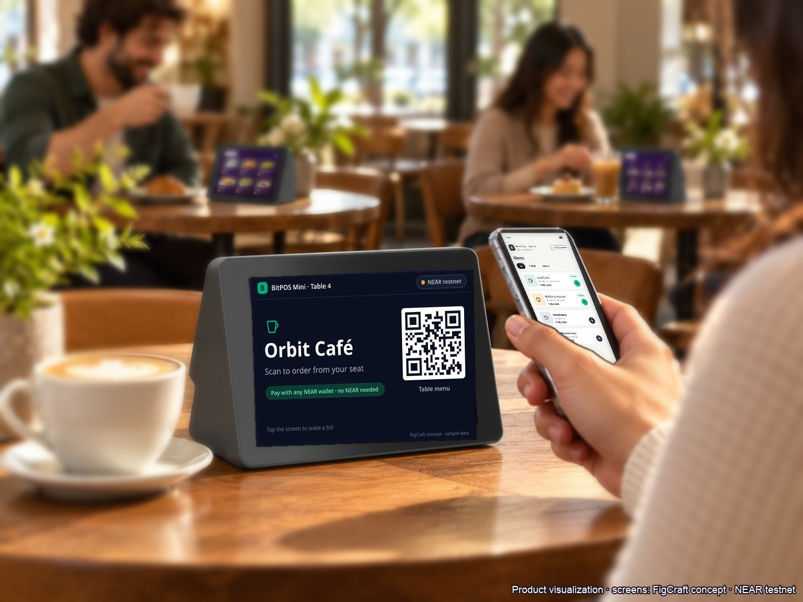

| | |
|---|---|
| 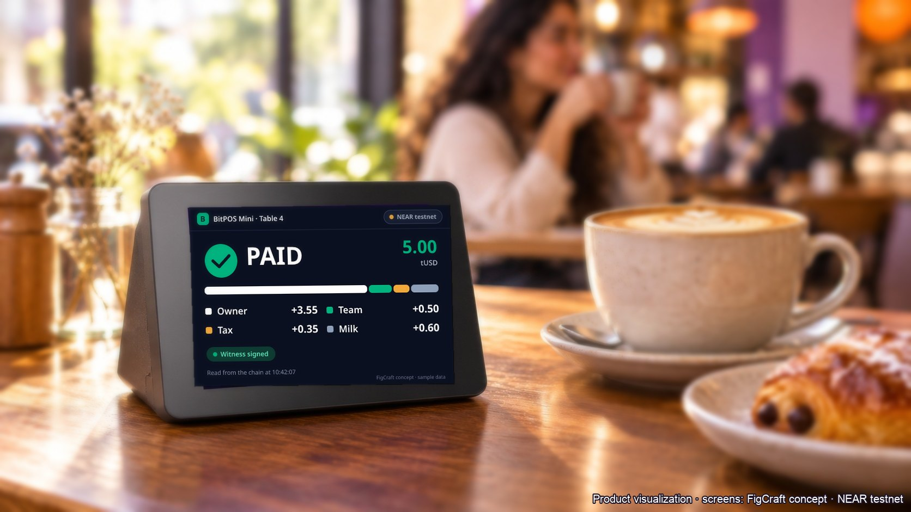 | 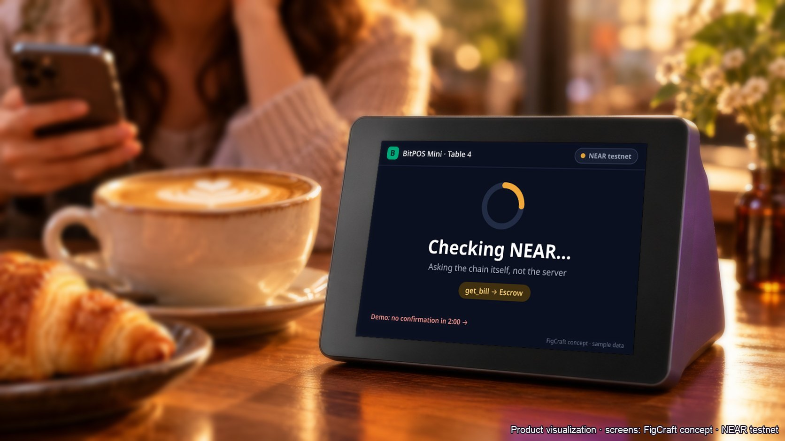 |
| The table screen shows **PAID** and the split it read from the chain | Witness mode: the screen asks NEAR itself before it signs |

The three photos above are product visualizations: BitPOS's AI café images with the English FigCraft screens of this edition placed on the device and phone. Everything below is a real screen from the running app on NEAR testnet (14 Nov 2026).

| Customer: where the money goes | Customer: paid and split | Customer: AI spending pass |
|---|---|---|
| 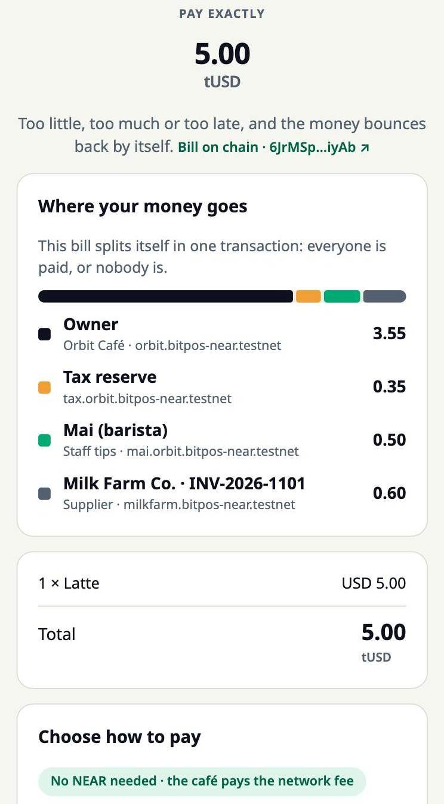 | 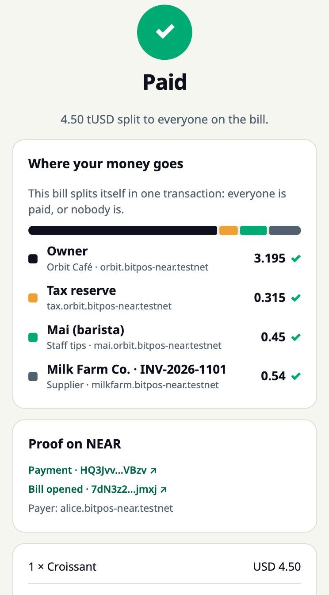 | 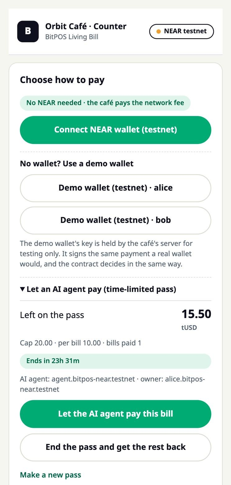 |

| Café: overview | Café: ledger with transaction links |
|---|---|
| 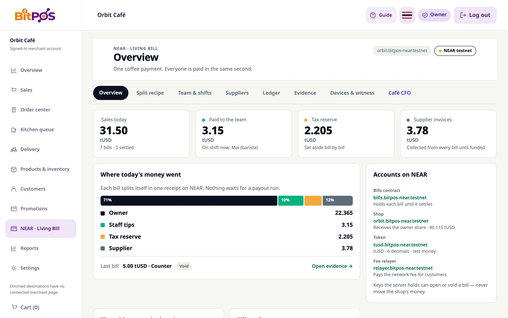 | 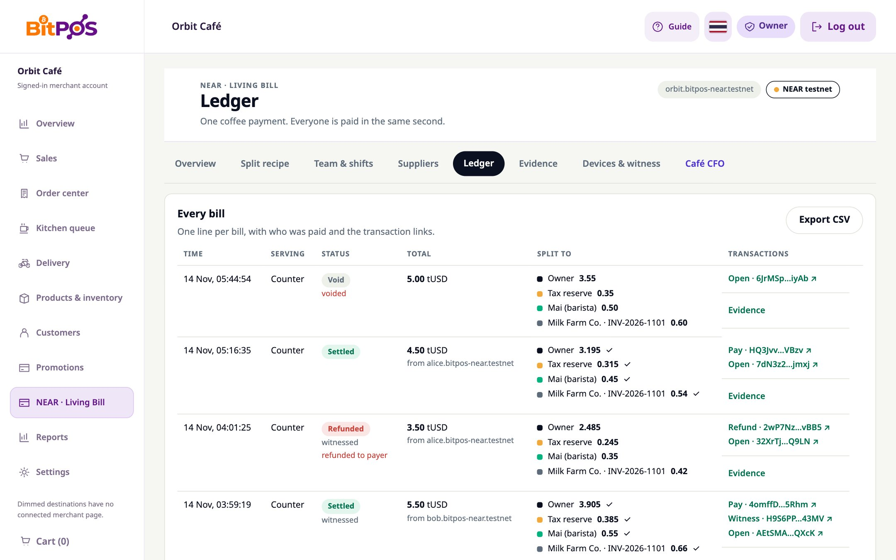 |
| **Café: payroll by the cup** | **Café: evidence timeline** |
| 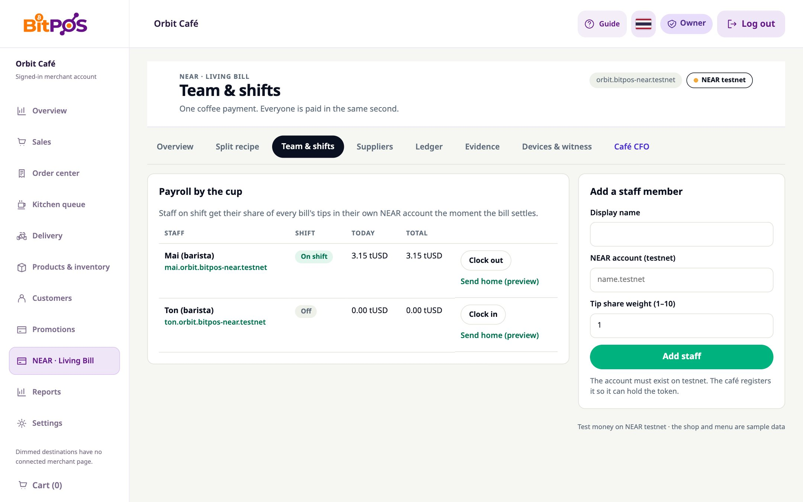 | 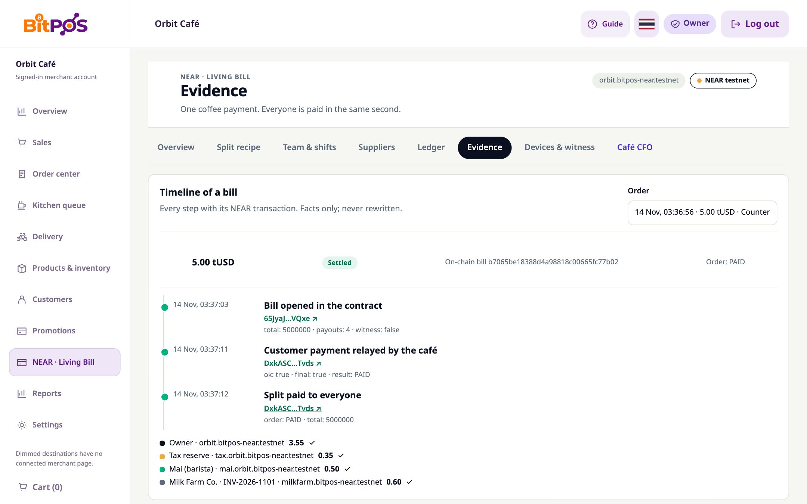 |
| **Café: suppliers that collect themselves** | **Café: split recipe** |
| 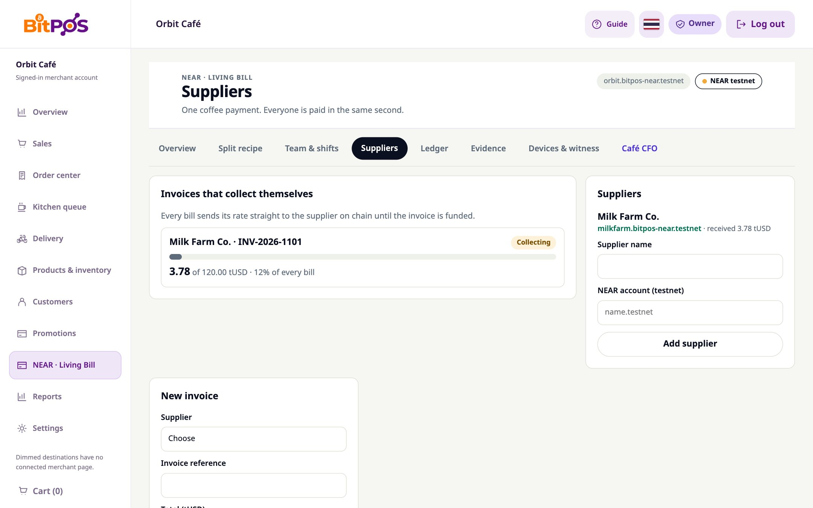 | 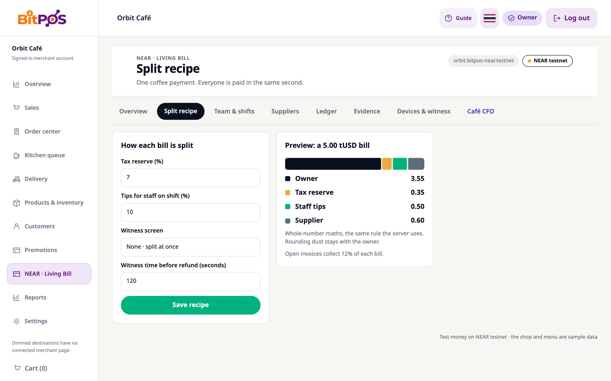 |
| **Café: devices and witness** | **Café: Café CFO (sample mode)** |
| 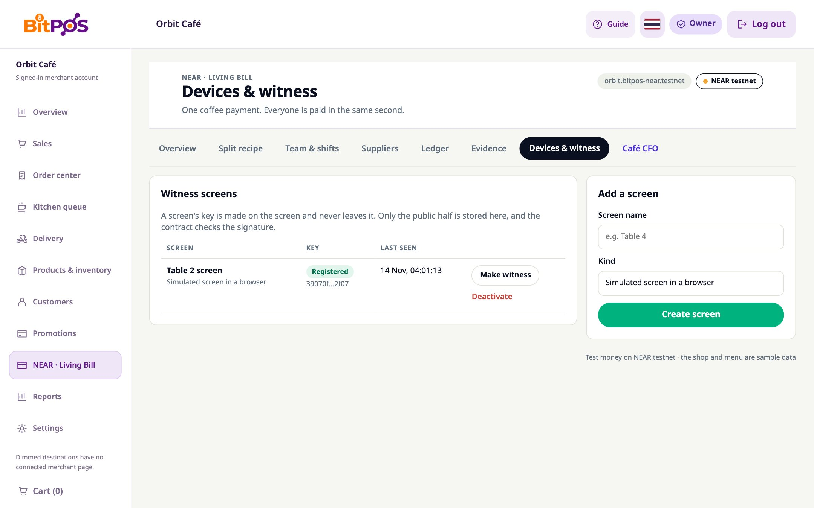 | 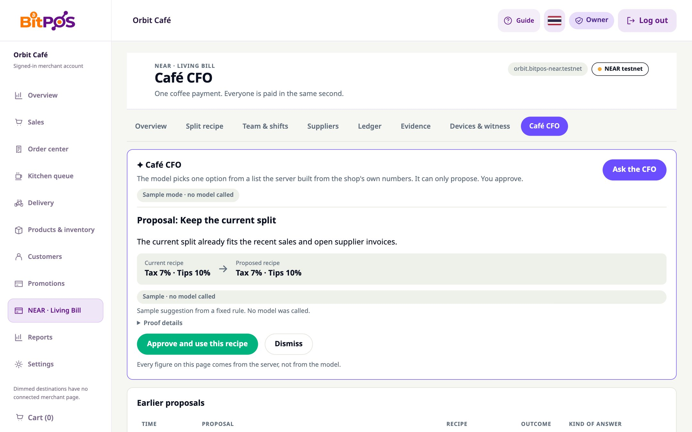 |

**Try it.**

| Do | See |
|---|---|
| Open [near-pos.cashlessthailand.com](https://near-pos.cashlessthailand.com) → **Owner** → **Menu** → register *Counter* → add a Latte → **View cart** → **Review order** → **Create order** → **Open payment** | the customer page on `near-pay…` with *Pay exactly 5.00 tUSD* after **Open my bill on NEAR** |
| On that page: **Demo wallet (testnet) · alice**, or **Let an AI agent pay** → pick a length → **Give the AI a pass** → **Let the AI agent pay this bill** | **Paid**, four ticked payouts (owner, tax, barista, supplier), a NEAR transaction link, and the agent's decision with its reason |
| Open a real payment on testnet: [one payment, four recipients](https://testnet.nearblocks.io/txns/AZBjrRxtFupDW2Driq7w6ynEwiLE7EBuLDNkjBhwNHGG) | 5.00 tUSD in; 3.55 / 0.50 / 0.35 / 0.60 out to owner, staff, tax, supplier |
| `python3 -I tools/near/fixture-db.py up`, create `.env` from `near-hackathon/local.env.example`, then `BITPOS_BACKEND_INTEGRATION=1 pnpm exec tsx --test --test-concurrency=1 tests/near-*.test.ts` | `pass 28`, `fail 0` |
| `cd contracts/near-bills && cargo test` | 23 contract tests pass |
| `pnpm exec tsx tools/near/e2e-chain.ts` (with your own testnet accounts, see the guide) | four real cases on testnet, `ALL PASSED`, explorer links |
| `pnpm exec tsx tools/near/e2e-pass.ts` | AI spending pass on testnet: create, agent pays, unserved bill refunded to the customer, pass closed |

Full steps, the code map and the honest list of limits: **[near-hackathon/JUDGES.md](near-hackathon/JUDGES.md)**.
Plan (Thai): [near-hackathon/PLAN_TH.md](near-hackathon/PLAN_TH.md). Contract: [contracts/near-bills](contracts/near-bills/src/lib.rs).
Deployed: `bills.bitpos-near.testnet` (see [near-deployment.json](near-hackathon/near-deployment.json)).

**Honest limits.** Testnet only, test money. The hosted demo's table and counter screens are simulated, except when the real BitPOS Mini is plugged in as the
witness: on 14 Nov it signed a real testnet payment ([device_ack](https://testnet.nearblocks.io/txns/8ECTxuJAPfrkPiDb98qCqkQsxQrrNb5w9BGtV3WQPiD5), key made on the device). NEAR Intents is a dry-quote preview (nothing executed). The Café CFO and the pass agent use
NEAR AI Cloud (the hosted demo has a key: verified response signatures, see [evidence](near-hackathon/evidence/near-ai-2026-11-14.md)); without a key they say "Sample · no model called". Chain Signatures are not used.
Full list: [JUDGES.md › Limits](near-hackathon/JUDGES.md#limits-honest-list).

**NEAR features used:** Rust contract with NEP-141 `ft_transfer_call`, batched promise payouts, on-chain
`ed25519_verify` for a hardware witness, NEP-366 meta transactions, function-call access keys (cashier key; AI agent key limited to `pass_pay`), named sub-accounts,
global contracts, NEAR Intents 1Click (dry-quote preview only), NEAR AI Cloud with response-signature verification.

**Libraries and services:** listed in [PROVENANCE.md](near-hackathon/PROVENANCE.md#third-party-code-and-services)
and [docs/THIRD_PARTY_NOTICES.md](docs/THIRD_PARTY_NOTICES.md). Licence: Apache-2.0 ([LICENSE](LICENSE)).

---

# BitPOS

**Cafe checkout that connects a Solana payment to a physical BitPOS Mini.**

Built by Natthapong Suwanjit. Merchant tablets create itemized bills; customers scan an order or table QR, order on their own phone and authorize a merchant-sponsored stablecoin transaction on Solana devnet. Finalized on-chain verification updates the bill, inventory and the assigned ESP32 display through a durable outbox.

## Tried in a cafe

### Watch: order and pay from the table

**[▶ Watch on YouTube — about 61 seconds](https://youtu.be/kNcwEB3NNxY)**

A phone order, USDG payment and the physical BitPOS Mini at the cafe table. Click the preview to watch on YouTube, with English titles and background music.

**Real hardware, a tablet, a phone and a cafe table.** Watch [table ordering and payment](https://youtu.be/kNcwEB3NNxY) or [tablet order to device QR](https://youtu.be/Yy9Dx9Kik-Q). See the [captioned field-trial gallery](RealUse/README.md) for all four recordings, three photos and provenance. The recordings show a devnet trial, not claimed commercial adoption.

## Review the submission

Start with the [English reviewer guide](docs/JUDGE_GUIDE.md), [development history](docs/SOURCE_PROVENANCE.md), [third-party notices](docs/THIRD_PARTY_NOTICES.md) and [submission checklist](docs/SUBMISSION_CHECKLIST.md). Watch the [two-minute English pitch](https://youtu.be/q8YXIrsTWXw) and [combined four-clip cafe demo with music](https://youtu.be/yuSbXrgXSh8). The original individual recordings remain available above.

## Try the application

- Product website: https://bitpos.cashlessthailand.com/
- Merchant POS: https://pos.cashlessthailand.com/
- Table ordering: https://pay.cashlessthailand.com/table/6LSn6twjmnvfGpDwTWm98p8S8o4CQqlZ8CwlK_nk1CY
- English reviewer overview: https://guide.cashlessthailand.com/judges/

The public merchant application intentionally offers Owner, Manager and Staff quick access for evaluation. This is a dedicated **Solana devnet** deployment; do not enter personal information or real funds. USDG here is the Paxos sandbox token, not redeemable money. Mainnet is disabled.

## Latest product updates — 13 October 2026

The submitted competition build and subsequent development have separate evidence. Read the [latest feature and evidence summary](docs/PRODUCT_UPDATES_20261013.md) for deployed extensions. Historical cafe recordings and payment acceptance remain unchanged.

- **AI promotions:** real Gemini drafts, merchant preview/approval, daily campaigns and customer-specific offers. Staff inspect a Mini from the floor plan and choose its promotion. An approved Espresso Deal reached the physical Mini with an authenticated render acknowledgment.
- **Multi-asset devnet payments:** USDG, official Circle devnet USDC and **BitPOS-issued USDT-test**. Server-frozen integer quotes preserve the original bill. USDT-test is not official Tether USDT.
- **Coffee Copilot / x402 V2:** order proposals, reviewed repeat orders and bounded USDC permissions. Actual devnet HTTP settlement and delegated-order evidence are separate from physical microphone/phone testing.
- **Pickup:** staff select an order and mark it ready; fulfillment is separate from payment and notifications retain the assigned device.

*Physical ESP32 native frame after LCD transfer, not a mockup. Gemini drafted the offer; the photo is an existing menu asset. Sound and optical camera capture are separate evidence.*

These extensions run on the existing OCI deployment. This documentation update does not publish the full post-submission implementation or certify every physical flow. Credentials, signing wallets and private operational evidence are excluded.

## Implemented

- Merchant menu/cart, customer records, deterministic wallet avatars, per-role server authorization.
- Table QR ordering and one BitPOS Mini pairing per tablet register; bills retain their original device and table assignment.
- Merchant-sponsored stablecoin transactions, frozen integer quotes and server verification of mint, recipient, amount, reference and signatures.
- Finalized-only settlement, inventory changes and durable device delivery; replay protection, reconciliation and authenticated render acknowledgments.
- Small-screen ESP-IDF/LVGL firmware, QR payment/order screens, status feedback, product carousel, animation and payment audio.
- English/Thai interfaces and local offline product documentation.

The current customer flow uses an order website and the Phantom in-app provider. AI offers require merchant approval. Native Actions/Blinks integration, loyalty/NFT rewards and full legacy POS feature parity remain planned or incomplete; presentation concepts do not certify runtime support. Browser signing fixtures are explicitly separate from physical Android Phantom testing.

## Why Solana

Low network fees suit small-value orders. Solana's separate fee-payer support lets the merchant sponsor network fees while the customer signs the stablecoin transfer. BitPOS uses its own sponsor adapter for supported devnet assets; Kora is a proposed integration, not a label for the existing adapter. [Official fee-sponsorship guide](https://solana.com/docs/payments/send-payments/payment-processing/fee-abstraction).

## One connected order

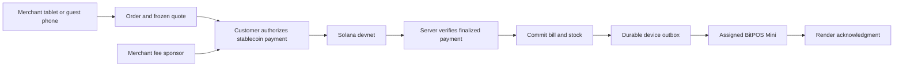

Each order retains its table/device identity. A counter bill goes to its register's paired screen; it is not broadcast to other tables.

## Source map

| Path | Purpose |
| --- | --- |
| `apps/web` | Astro / React merchant and customer interfaces |
| `apps/api` | TypeScript HTTP API, payment builder/verifier and device WebSocket |
| `apps/worker` | Finalization reconciliation and durable delivery |
| `packages` | Shared contracts, money and pricing rules |
| `supabase/migrations` | PostgreSQL tenant isolation and business schema |
| `device/firmware` | Standalone ESP32-S3 / LVGL terminal firmware |
| `infra/oci` | OCI application containers, public proxies and tunnel |
| `tests` | Domain, authorization, payment and recovery checks |
| `team-guide` | Offline HTML product documentation |

## Local setup

Use Node.js 24 and `pnpm@11.19.0`. Run `pnpm install --frozen-lockfile`, create a private `.env` from `.env.example`, configure a dedicated PostgreSQL/Supabase instance, and apply `pnpm db:migrate`. Start `pnpm dev:api`, `pnpm dev:worker` and `pnpm dev:web` in separate terminals. A funded devnet fee sponsor is required for real transactions; secrets and signing wallets are deliberately excluded.

Validation: `pnpm typecheck`, `pnpm test`, `pnpm build`. Some integration tests require an explicitly configured database and `BITPOS_BACKEND_INTEGRATION=1`; skipped tests do not prove integration success. Firmware build and identity-checked USB installation instructions are in `device/firmware/README.md` and `tools/firmware`.

See [OCI deployment](docs/OCI_DEPLOYMENT.md), [source provenance](docs/SOURCE_PROVENANCE.md), [firmware provenance](docs/FIRMWARE_PROVENANCE.json) and [photo credits](docs/CAFE_PHOTO_CREDITS.md). Hardware board/display foundations and brand references were inherited from CryptoClock Pro; the standalone BitPOS lifecycle, checkout, payment reconciliation, table routing and customer interfaces were developed separately. The original CryptoClock workspace is not needed to build this repository.

## Historical deployment acceptance — firmware 0.3.6

Web/API/worker, public proxies and the named tunnel run on OCI against the existing dedicated BitPOS Supabase database. The original cohort used firmware 0.3.6 over authenticated WSS. Latest promotion evidence uses firmware 0.3.9, as documented above. Three fresh sponsored devnet payments finalized while all Mac application services and tunnel connectors were stopped; all three received physical render ACKs. Observed backend-to-render latencies were 404 / 344 / 329 ms (three observations, not a p95 estimate or chain-finalization time). These three observations describe that acceptance cohort, not the total number of trials. Counter/table routing, one settlement per bill, inventory, duplicate submission, restart recovery, audio deduplication and customer Done returning to the table menu were checked. See [deployment acceptance](docs/DEPLOYMENT_ACCEPTANCE.md). The Mac was used as a test client/USB observer, not a server. Physical Android Phantom testing remains separate.

## License

Project-owned source code is licensed under [Apache-2.0](LICENSE), copyright 2026 Natthapong Suwanjit. See [NOTICE](NOTICE) and [third-party notices](docs/THIRD_PARTY_NOTICES.md) for scope and retained upstream terms. Logos, brand artwork and product illustrations are excluded from this source-code grant; trademark rights are not granted. Third-party photos and fonts retain their own licenses.
