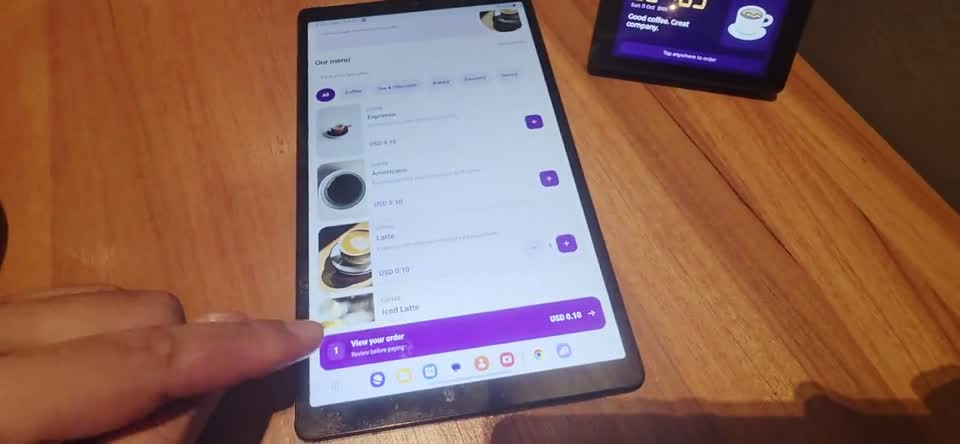
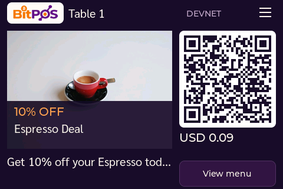
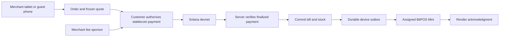

# BitPOS

**Cafe checkout that connects a Solana payment to a physical BitPOS Mini.**

Built by Natthapong Suwanjit. Merchant tablets create itemized bills; customers scan an order or table QR, order on their own phone and authorize a merchant-sponsored stablecoin transaction on Solana devnet. Finalized on-chain verification updates the bill, inventory and the assigned ESP32 display through a durable outbox.

## Tried in a cafe

### Watch: order and pay from the table

**[▶ Watch on YouTube — about 61 seconds](https://youtu.be/kNcwEB3NNxY)**

A phone order, USDG payment and the physical BitPOS Mini at the cafe table. Click the preview to watch on YouTube, with English titles and background music.

**Real hardware, a tablet, a phone and a cafe table.** Watch [table ordering and payment](https://youtu.be/kNcwEB3NNxY) or [tablet order to device QR](https://youtu.be/Yy9Dx9Kik-Q). See the [captioned field-trial gallery](RealUse/README.md) for all four recordings, three photos and provenance. The recordings show a devnet trial, not claimed commercial adoption.

## Review the submission

Start with the [English reviewer guide](docs/JUDGE_GUIDE.md), [development history](docs/SOURCE_PROVENANCE.md), [third-party notices](docs/THIRD_PARTY_NOTICES.md) and [submission checklist](docs/SUBMISSION_CHECKLIST.md). Watch the [two-minute English pitch](https://youtu.be/q8YXIrsTWXw) and [combined four-clip cafe demo with music](https://youtu.be/yuSbXrgXSh8). The original individual recordings remain available above.

## Try the application

- Product website: https://bitpos.cashlessthailand.com/
- Merchant POS: https://pos.cashlessthailand.com/
- Table ordering: https://pay.cashlessthailand.com/table/6LSn6twjmnvfGpDwTWm98p8S8o4CQqlZ8CwlK_nk1CY
- English reviewer overview: https://guide.cashlessthailand.com/judges/

The public merchant application intentionally offers Owner, Manager and Staff quick access for evaluation. This is a dedicated **Solana devnet** deployment; do not enter personal information or real funds. USDG here is the Paxos sandbox token, not redeemable money. Mainnet is disabled.

## Latest product updates — 13 October 2026

The submitted competition build and subsequent development have separate evidence. Read the [latest feature and evidence summary](docs/PRODUCT_UPDATES_20261013.md) for deployed extensions. Historical cafe recordings and payment acceptance remain unchanged.

- **AI promotions:** real Gemini drafts, merchant preview/approval, daily campaigns and customer-specific offers. Staff inspect a Mini from the floor plan and choose its promotion. An approved Espresso Deal reached the physical Mini with an authenticated render acknowledgment.
- **Multi-asset devnet payments:** USDG, official Circle devnet USDC and **BitPOS-issued USDT-test**. Server-frozen integer quotes preserve the original bill. USDT-test is not official Tether USDT.
- **Coffee Copilot / x402 V2:** order proposals, reviewed repeat orders and bounded USDC permissions. Actual devnet HTTP settlement and delegated-order evidence are separate from physical microphone/phone testing.
- **Pickup:** staff select an order and mark it ready; fulfillment is separate from payment and notifications retain the assigned device.

*Physical ESP32 native frame after LCD transfer, not a mockup. Gemini drafted the offer; the photo is an existing menu asset. Sound and optical camera capture are separate evidence.*

These extensions run on the existing OCI deployment. This documentation update does not publish the full post-submission implementation or certify every physical flow. Credentials, signing wallets and private operational evidence are excluded.

## Implemented

- Merchant menu/cart, customer records, deterministic wallet avatars, per-role server authorization.
- Table QR ordering and one BitPOS Mini pairing per tablet register; bills retain their original device and table assignment.
- Merchant-sponsored stablecoin transactions, frozen integer quotes and server verification of mint, recipient, amount, reference and signatures.
- Finalized-only settlement, inventory changes and durable device delivery; replay protection, reconciliation and authenticated render acknowledgments.
- Small-screen ESP-IDF/LVGL firmware, QR payment/order screens, status feedback, product carousel, animation and payment audio.
- English/Thai interfaces and local offline product documentation.

The current customer flow uses an order website and the Phantom in-app provider. AI offers require merchant approval. Native Actions/Blinks integration, loyalty/NFT rewards and full legacy POS feature parity remain planned or incomplete; presentation concepts do not certify runtime support. Browser signing fixtures are explicitly separate from physical Android Phantom testing.

## Why Solana

Low network fees suit small-value orders. Solana's separate fee-payer support lets the merchant sponsor network fees while the customer signs the stablecoin transfer. BitPOS uses its own sponsor adapter for supported devnet assets; Kora is a proposed integration, not a label for the existing adapter. [Official fee-sponsorship guide](https://solana.com/docs/payments/send-payments/payment-processing/fee-abstraction).

## One connected order

Each order retains its table/device identity. A counter bill goes to its register's paired screen; it is not broadcast to other tables.

## Source map

| Path | Purpose |
| --- | --- |
| `apps/web` | Astro / React merchant and customer interfaces |
| `apps/api` | TypeScript HTTP API, payment builder/verifier and device WebSocket |
| `apps/worker` | Finalization reconciliation and durable delivery |
| `packages` | Shared contracts, money and pricing rules |
| `supabase/migrations` | PostgreSQL tenant isolation and business schema |
| `device/firmware` | Standalone ESP32-S3 / LVGL terminal firmware |
| `infra/oci` | OCI application containers, public proxies and tunnel |
| `tests` | Domain, authorization, payment and recovery checks |
| `team-guide` | Offline HTML product documentation |

## Local setup

Use Node.js 24 and `pnpm@11.19.0`. Run `pnpm install --frozen-lockfile`, create a private `.env` from `.env.example`, configure a dedicated PostgreSQL/Supabase instance, and apply `pnpm db:migrate`. Start `pnpm dev:api`, `pnpm dev:worker` and `pnpm dev:web` in separate terminals. A funded devnet fee sponsor is required for real transactions; secrets and signing wallets are deliberately excluded.

Validation: `pnpm typecheck`, `pnpm test`, `pnpm build`. Some integration tests require an explicitly configured database and `BITPOS_BACKEND_INTEGRATION=1`; skipped tests do not prove integration success. Firmware build and identity-checked USB installation instructions are in `device/firmware/README.md` and `tools/firmware`.

See [OCI deployment](docs/OCI_DEPLOYMENT.md), [source provenance](docs/SOURCE_PROVENANCE.md), [firmware provenance](docs/FIRMWARE_PROVENANCE.json) and [photo credits](docs/CAFE_PHOTO_CREDITS.md). Hardware board/display foundations and brand references were inherited from CryptoClock Pro; the standalone BitPOS lifecycle, checkout, payment reconciliation, table routing and customer interfaces were developed separately. The original CryptoClock workspace is not needed to build this repository.

## Historical deployment acceptance — firmware 0.3.6

Web/API/worker, public proxies and the named tunnel run on OCI against the existing dedicated BitPOS Supabase database. The original cohort used firmware 0.3.6 over authenticated WSS. Latest promotion evidence uses firmware 0.3.9, as documented above. Three fresh sponsored devnet payments finalized while all Mac application services and tunnel connectors were stopped; all three received physical render ACKs. Observed backend-to-render latencies were 404 / 344 / 329 ms (three observations, not a p95 estimate or chain-finalization time). These three observations describe that acceptance cohort, not the total number of trials. Counter/table routing, one settlement per bill, inventory, duplicate submission, restart recovery, audio deduplication and customer Done returning to the table menu were checked. See [deployment acceptance](docs/DEPLOYMENT_ACCEPTANCE.md). The Mac was used as a test client/USB observer, not a server. Physical Android Phantom testing remains separate.

## License

Project-owned source code is licensed under [Apache-2.0](LICENSE), copyright 2026 Natthapong Suwanjit. See [NOTICE](NOTICE) and [third-party notices](docs/THIRD_PARTY_NOTICES.md) for scope and retained upstream terms. Logos, brand artwork and product illustrations are excluded from this source-code grant; trademark rights are not granted. Third-party photos and fonts retain their own licenses.
