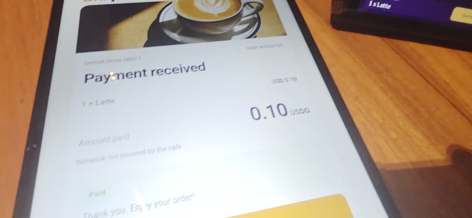
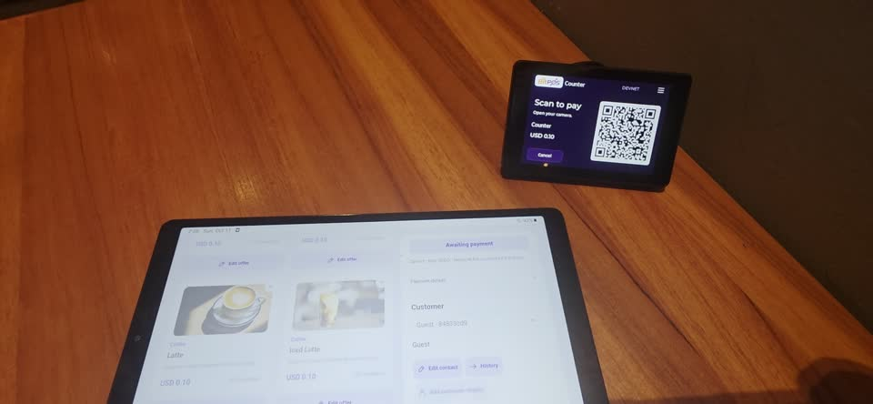
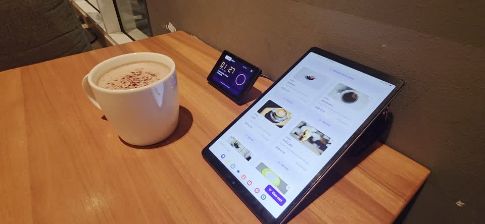
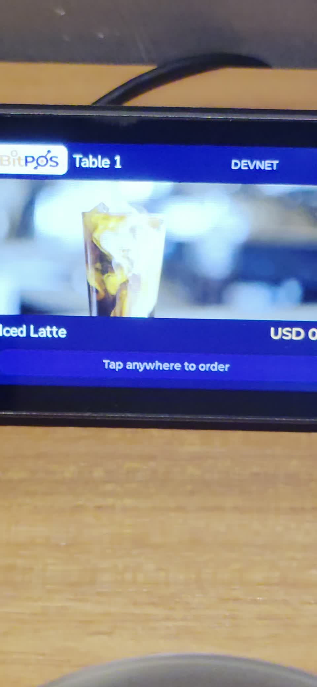
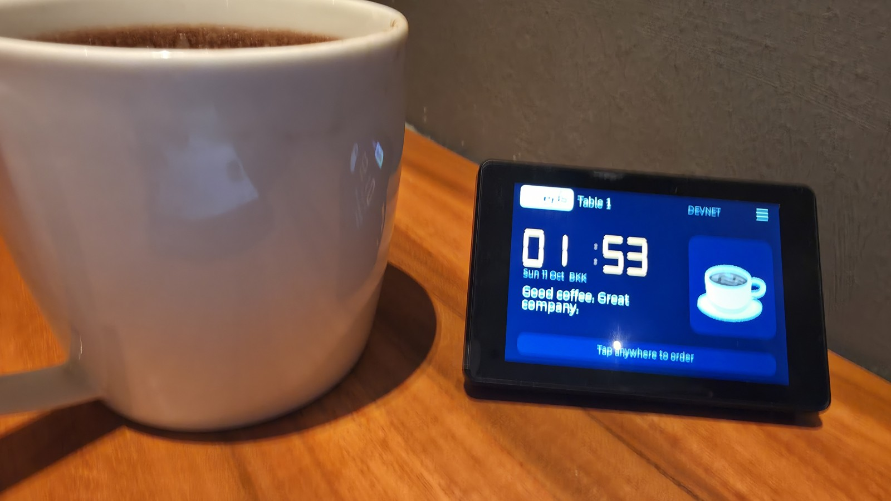
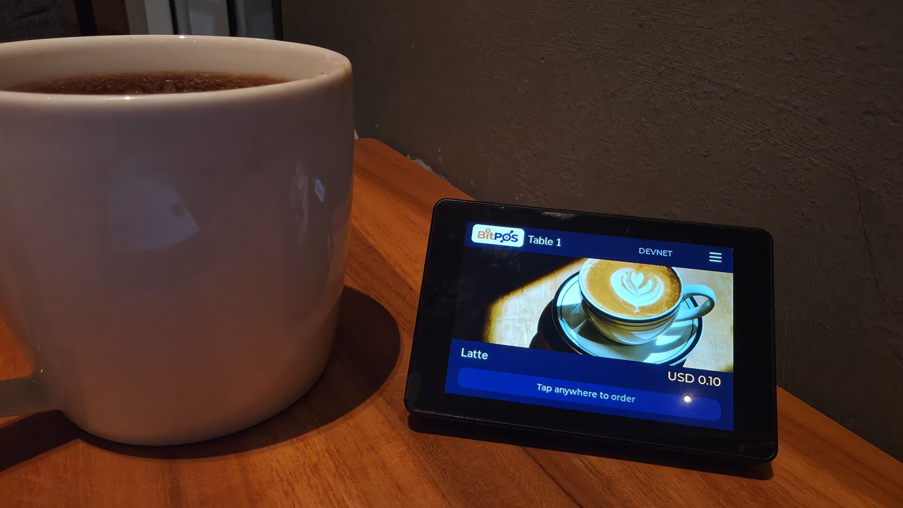
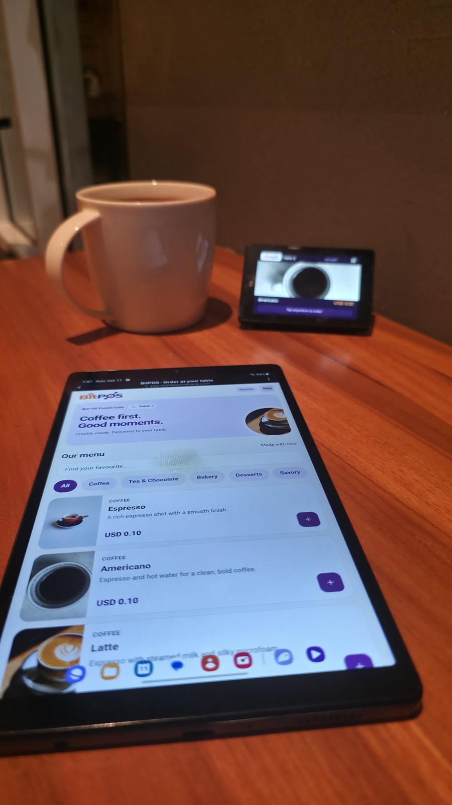

# BitPOS Mini — cafe field trial

Real photographs and phone-camera recordings supplied by the builder, published on 11 October 2026. These show BitPOS and **BitPOS Mini** being tried in a cafe setting: a merchant tablet, a customer's phone, the physical display, and a drink served at the table. They are camera footage, not Blender renders or motion-graphics reconstructions.

**Start here:** [table ordering and payment](media/bitpos_table.mp4), then [merchant tablet to payment QR](media/bitpos_shop.mp4).

## Watch the recordings

Click a still to open its MP4 on GitHub. If your browser does not play the repository file inline, use **View raw / Download** on that file page. These are supporting field-trial clips, separate from the final narrated presentation and product-demo videos.

### 1. Order and pay from the table — about 61 seconds

**Original filename:** `bitpos_table.mp4`. A guest uses a phone beside the table device, browses the menu, proceeds to the payment page, and reaches **Payment received** while the physical display shows its receipt state. The recording shows the customer-side flow in a cafe setting; on-chain settlement details should be checked against the separately linked technical evidence rather than inferred from a screen alone.

### 2. Merchant tablet and assigned display — about 43 seconds

**Original filename:** `bitpos_shop.mp4`. The operator opens BitPOS on a tablet, selects menu items and creates a bill. The adjacent BitPOS Mini changes from its idle/product display to that bill's payment QR. This clip focuses on creating an order and routing its QR to the physical device; it is not presented as a completed payment recording.

### 3. Cafe setup overview — about 14 seconds

**Original filename:** `overview.mp4`. A camera view of the tablet menu, BitPOS Mini and a drink on the table, showing the physical footprint and placement of the equipment.

### 4. Serving the drink at the table — about 16 seconds

**Original filename:** `bringcuptothetable.mp4`. The camera follows a drink to the table beside BitPOS Mini, whose screen alternates between the clock/idle view and a menu promotion. This demonstrates the table setting and product display, not an AI-personalized promotion or an additional payment.

## Photos

| Idle display beside the drink | Menu promotion on the same device |
| --- | --- |
|  |  |

The photographs correspond to `20261011_015343.jpg`, `20261011_015356.jpg` and `20261011_015725.jpg`, respectively. The menu promotion is the existing product carousel; the photos do not establish an AI campaign, NFT reward or review feature.

## What this evidence establishes

- The product has been physically tried in a cafe setting, beyond renderings or browser-only prototypes.
- Tablet ordering, mobile ordering/payment screens, physical QR display and the idle/menu carousel can be inspected in the recordings.
- This is a **Solana devnet field trial with sandbox USDG**. It does not establish mainnet sales, paid merchant adoption, independent customer counts, revenue or repeat-use metrics.
- [Deployment acceptance](../docs/DEPLOYMENT_ACCEPTANCE.md) provides separately recorded transaction links and device render-ACK evidence. Its three measured acceptance rounds are one documented test cohort, not the total number of trials performed.

## Viewing copies and provenance

Original files remain unchanged on the builder's Mac. Published copies preserve the complete video sequence; container durations can differ slightly when the original audio tail is omitted, with H.264 compression, resized video, and metadata removed. Audio is omitted from the web copies; original audio remains in the local recordings. Photos are resized/oriented and have EXIF stripped. Poster frames are extracted from the corresponding footage. There are no generated replacements, composited payment screens or invented transaction overlays.

[manifest.json](manifest.json) records original filenames, hashes, published hashes, durations and transformations. Raw local originals are excluded from Git to avoid oversized duplicate files. User-supplied recordings and photographs remain subject to the owner's rights and applicable appearance/location permissions; the repository's source-code Apache-2.0 grant does not automatically license this media.
