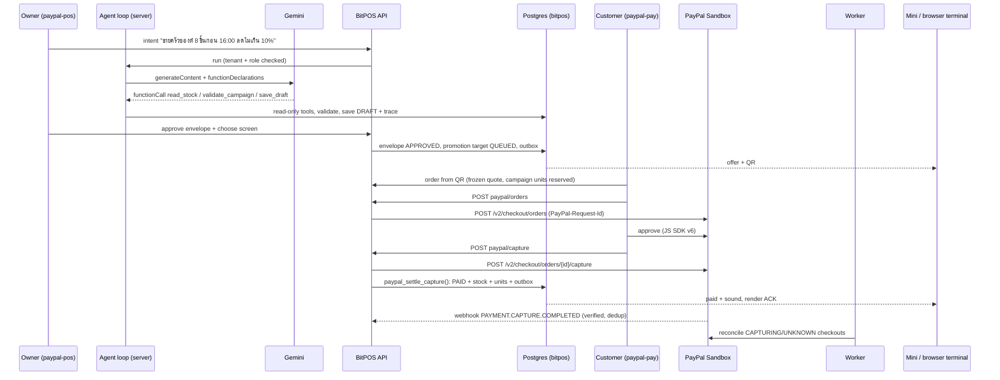

# แผน Implement — BitPOS × PayPal (Café Copilot)

> ฉบับที่ 1 · 31 ต.ค. 2026 (Asia/Bangkok) · branch `hackathon/paypal-2026` · worktree `~/Desktop/BitPOS-PayPal-2026` · baseline tag `paypal-hackathon-baseline` (`9eb34ea`)
> เอกสารนี้แปลง [PLAN_TH.md](PLAN_TH.md) และ WIN_STRATEGY_TH.md (`WIN_STRATEGY_TH.md`, private) เป็นงานที่ลงมือได้ทีละขั้น **ยังไม่มีขั้นใดทำเสร็จ** ทุกช่อง `[ ]` คือยังไม่ทำ

## รายละเอียดแยกตามหัวข้อ

| ไฟล์ | เนื้อหา |
|---|---|
| [plan/01_PAYPAL_INTEGRATION_TH.md](plan/01_PAYPAL_INTEGRATION_TH.md) | ข้อเท็จจริงจากเอกสาร PayPal (SDK v6, Orders v2, webhook, idempotency), config, สัญญาฟังก์ชัน, payload create/capture, ตารางผลลัพธ์ capture, การ verify 9 ข้อ, webhook, worker reconcile, front-end, ข้อความ error TH/EN |
| [plan/02_DATA_MODEL_TH.md](plan/02_DATA_MODEL_TH.md) | ร่าง SQL ของ migrations 400–405, mutex สองช่องทาง, `paypal_settle_capture()` ทีละขั้น, inbox webhook, campaign envelope/units, agent trace, seed ร้านเดโม |
| [plan/03_AI_AGENT_TH.md](plan/03_AI_AGENT_TH.md) | บทบาท, loop, tools 5 ตัว, violation codes, system prompt, rules baseline, flow หลัง draft, งบการเรียกจริง |
| [plan/04_UI_TH.md](plan/04_UI_TH.md) | หน้าจ่ายลูกค้า, Café Copilot, Outcome, Evidence trace, จอ, i18n |
| [plan/05_TESTS_TH.md](plan/05_TESTS_TH.md) | test IDs ระดับ U/D/I/S/H/P พร้อมผลที่คาด |
| [plan/06_DEPLOY_OPS_TH.md](plan/06_DEPLOY_OPS_TH.md) | ตั้งเครื่อง local, env, deploy OCI ทีละขั้น, rollback, monitoring ถึง 15 ธ.ค., git |
| [plan/07_DAILY_TASKS_TH.md](plan/07_DAILY_TASKS_TH.md) | งานรายวัน 1–12 พ.ย. แยกงานย่อย/เวลา/commit/gate และลำดับการตัด scope |
| [plan/08_SUBMISSION_TH.md](plan/08_SUBMISSION_TH.md) | โครง JUDGES.md, ช่อง Devpost ที่ต้องแก้, โครงวิดีโอ, ตาราง provenance |

ถ้าไฟล์ย่อยกับไฟล์นี้ขัดกัน ให้ยึดไฟล์ย่อย (ละเอียดกว่าและตรวจกับเอกสาร PayPal แล้ว)

## 0. สถานะจริงวันนี้

| เรื่อง | ข้อเท็จจริงที่ตรวจแล้ว (31 ต.ค.) | ผลต่อแผน |
|---|---|---|
| Deadline | 12 พ.ย. 12:00 PST = **13 พ.ย. 03:00 ไทย**; แก้ submission ได้จนถึงเวลานั้น; กรรมการต้องเข้าถึงได้ถึง **15 ธ.ค. 23:00 ไทย** | เป้าส่งภายใน **11 พ.ย. 18:00** เหลือเวลาทำงาน ~11 วัน |
| Devpost | ส่งแล้ว (1259502) เมื่อ 25 ต.ค. พร้อมระบุว่า **ยังไม่ได้เชื่อม PayPal จริง**; วิดีโอ YouTube เป็นคลิปแนวคิดของสินค้า | ต้องแก้ story, URL เดโม และวิดีโอให้ตรงกับของที่ทำงานได้จริง |
| โค้ด | ไม่มีโค้ด PayPal ใน branch ไหนเลย; `hackathon/paypal-2026` = `9eb34ea` | PayPal ทั้งหมดเป็นงานใหม่ |
| Sandbox | มีแอป "BitPOS AI Hackathon 2026" (Merchant, TH Business sandbox, เปิด JS SDK v6) มี Client ID/Secret; **ยังไม่มี webhook** | Phase 0 ดึง credentials เก็บแบบ private และสร้าง sandbox buyer |
| Settlement เดิม | `payment_attempts`/`payments` บังคับ `signature`, `mint`, `token_program` และ `settle_verified_attempt()` ตรวจ Solana อย่างเดียว | ต้องมี ledger ของ PayPal เอง + ฟังก์ชัน settle ใหม่ที่ทำผลแบบเดียวกัน ห้ามยัด PayPal ID ลงช่อง signature |
| DB ที่ OCI | ใช้ร่วมกัน: migrations ของ h2 ถึง `176`, ของ Meta `300–327` (`meta_*`) | PayPal ใช้เลข **400–449** และ prefix `paypal_` เท่านั้น |
| โค้ด baseline vs DB | baseline มี migrations ถึง `137`; DB จริงอยู่ที่ `176` | ต้องเลือกฐานโค้ด (ดู D1) |
| AI | baseline มี Gemini adapter (`BITPOS_AI_*`), production มี `gemini-2.5-flash-lite` (free tier) ที่เคยสร้าง draft จริงได้ | ใช้ adapter/budget ledger เดิม แล้วเพิ่ม tool-calling loop ใหม่ |
| Firmware | `bitpos_table.c` รับเมนู `USD` 2/4 ทศนิยมได้ แต่ `table_settlement()` (บรรทัด ~361) รับ settlement ได้เฉพาะ `network="solana:devnet"` + mint/genesis ของ USDG/USDC/USDT (แก้ข้อมูลเมื่อ 31 ต.ค.) | จอ paid บน Mini สำหรับ PayPal **ต้องแก้ firmware และแฟลชใหม่** → ย้ายเป็น P1; browser terminal เป็นเส้นทาง P0 |
| Meta | ส่งงาน 5 พ.ย. 09:00 ไทย และใช้ OCI/DB/tunnel ร่วมกัน | **ห้ามแตะ OCI ก่อน 5 พ.ย. 09:00**; ช่วงแรกพัฒนาในเครื่องเท่านั้น |

## 1. การตัดสินใจที่ต้องยืนยันก่อนเริ่ม

| # | เรื่อง | ทางที่แนะนำ | ทางเลือกอื่น / เหตุผล |
|---|---|---|---|
| D1 | ฐานโค้ด POS | **คัดลอกไฟล์ POS ปัจจุบันจาก `codex/bitpos-h2-local-scope-20261027` ที่ commit ที่ระบุ** (apps/api, apps/web, packages, worker, migrations 138–176) เป็น commit เดียว แบบเดียวกับที่ Meta ทำ และระบุใน PROVENANCE ว่าเป็นงานเดิม | ใช้ baseline `9eb34ea` ต่อ ซึ่งเสี่ยงพังกับ DB 176 บน OCI และต้องตั้ง DB แยกให้กรรมการ; **ไม่ merge history ของ h2** |
| D2 | ร้านเดโม | **สร้าง tenant ใหม่ "BitPOS PayPal Café"** (USD 2 ทศนิยม, ปิดตัวเลือกจ่ายด้วย crypto ของร้านนี้ผ่าน config) | ใช้ Purple Cafe ร่วมกับ Solana/Meta ซึ่ง Meta แก้ราคา Latte ไว้แล้ว ทำให้ข้อมูลชนกัน |
| D3 | โดเมน/รันไทม์ | **container `bitpos-paypal` (127.0.0.1:3103)** ที่ `paypal-pay.cashlessthailand.com` (ลูกค้า) และ `paypal-pos.cashlessthailand.com` (ร้าน) | ใช้ path `/paypal/` บน `pay.` ซึ่งปน CSP/cookie กับ Solana |
| D4 | AI model | **Gemini `gemini-2.5-flash-lite` ผ่าน adapter เดิม** แบบ function calling; ทดสอบด้วย stub และเรียกจริงไม่เกิน ~15 ครั้งตลอดงาน | ใช้ model เสียเงิน ซึ่งต้องกำหนดงบก่อน |
| D5 | การเข้าถึงของกรรมการ | **เว็บที่ host ไว้ + ปุ่ม demo sign-in ของร้าน + sandbox buyer ที่ให้ในช่อง testing instructions** และบอกว่าใช้ sandbox personal account ของกรรมการเองได้ | ให้กรรมการตั้งระบบเอง (BYO) อย่างเดียว ซึ่งยากเกินสำหรับ POS |
| D6 | PayPal Agent Toolkit / MCP | **P1** ทำเมื่อ P0 ผ่านภายใน 8 พ.ย. เท่านั้น (เครื่องมือแบบอ่านอย่างเดียว) | ทำตั้งแต่แรก ซึ่งเสี่ยงไม่จบ core |
| D7 | เอกสารที่จะ commit ขึ้น repo สาธารณะ | commit `IMPLEMENTATION_PLAN_TH`, `PROVENANCE`, `JUDGES`, `SUBMISSION_EN`, `README`; **ไม่ commit** `WIN_STRATEGY_TH`, `MERCHANT_CASHFLOW_RESEARCH_TH`, `SETUP_HANDOFF_20261025`, `video-upload-*.json` และไฟล์ FigCraft/media ขนาดใหญ่ | memory ระบุว่า competitor research และ media ไม่อยู่ใน public baseline |

## 2. ขอบเขต

**P0 (ต้องมีก่อนส่ง):**
1. PayPal Orders v2 แบบ `CAPTURE` ฝั่ง server: OAuth, create, capture, get order/capture (JS SDK v6 ใช้ Client ID ตรงๆ ไม่ต้องมี client token ตามเอกสารปัจจุบัน)
2. Ledger ของ PayPal + settlement แบบ atomic (paid + stock + outbox + เสียงบนจอ) ทำครั้งเดียวต่อ order
3. หน้า checkout ลูกค้า: ปุ่ม PayPal บนหน้า `/pay/[accessToken]` เดิม
4. Webhook ที่ตรวจลายเซ็น + inbox กันซ้ำ + worker reconcile
5. AI agent ที่ใช้ tools: เจตนาของร้าน → draft campaign ที่มีขอบเขต (สินค้า/จำนวนสูงสุด/ส่วนลดสูงสุด/เวลาจบ/จอ) → ร้านอนุมัติ → ส่งไปจอ
6. Campaign quantity cap ที่จองใน transaction เดียวกับ stock
7. หน้าผลลัพธ์ campaign + evidence trace (intent → tool steps → approval → quote → PayPal order → capture → outbox/render ACK)
8. Browser terminal เป็นเส้นทางหลักของกรรมการ และ Mini แสดง `USD · PayPal`
9. Judge packet อังกฤษ (`JUDGES.md`) + PROVENANCE + วิดีโอใหม่ต่ำกว่า 3 นาที

**P1 (เมื่อ P0 ผ่าน):** AI อธิบายผล campaign จากตัวเลขที่ code คำนวณ · redirect fallback สำหรับ in-app browser · refund แบบให้ร้านยืนยันเอง · PayPal Agent Toolkit แบบอ่านอย่างเดียว · ทดสอบกับคนขาย/ลูกค้าจริง (ทำหลังซอฟต์แวร์เสร็จ)

**ไม่ทำ:** Live PayPal, Venmo, Pay Later, subscription, payout, vault, multi-seller/partner onboarding, AI ที่ capture/refund/publish เอง, ใช้โค้ด `meta/*` หรือ Stripe ของ Meta (เป็นงานของอีกการแข่งขัน), ลบฟีเจอร์ Solana (แค่ปิดใน tenant เดโม)

## 3. สถาปัตยกรรม



### 3.1 กติกาโค้ด
- ไฟล์ใหม่ทุกไฟล์ขึ้นต้นด้วย `// PayPal AI Hackathon work (2026-10-31..11-12). See paypal-hackathon/PROVENANCE.md.`
- โค้ดใหม่อยู่เฉพาะ: `apps/api/src/paypal/`, `apps/worker/src/paypal-*.ts`, `apps/web/src/components/paypal/`, `apps/web/src/lib/paypal-*.ts`, `supabase/migrations/4xx_paypal_*.sql`, `tests/paypal-*.test.ts`, `tools/paypal/`, `paypal-hackathon/`
- แก้ไฟล์เดิมให้น้อยที่สุด (เช่น mount routes ใน `index.ts`, เพิ่มปุ่มใน `Payment.tsx`, ให้ expiry ไม่ปล่อย order ที่กำลัง capture) และบันทึกทุกไฟล์ใน PROVENANCE
- เงินเป็น `bigint`/decimal string เสมอ ห้ามใช้ float; ยอดที่ส่ง PayPal มาจาก quote ฝั่ง server เท่านั้น
- Secrets อยู่ที่ `~/.bitpos-paypal/paypal-sandbox.env` (chmod 600) บน Mac และไฟล์ env private บน OCI; ไม่มี `PUBLIC_` prefix; commit แค่ `paypal-hackathon/paypal.env.example` ที่มีแต่ชื่อตัวแปร
- ปฏิเสธ live เสมอ: ถ้า base URL ไม่ใช่ `https://api-m.sandbox.paypal.com` ให้ throw `LIVE_MODE_REFUSED`

### 3.2 ไฟล์ที่จะสร้าง

| ไฟล์ | หน้าที่ |
|---|---|
| `apps/api/src/paypal/config.ts` | parse env (`PAYPAL_ENVIRONMENT`, `PAYPAL_API_BASE_URL`, `PAYPAL_CLIENT_ID`, `PAYPAL_CLIENT_SECRET`, `PAYPAL_MERCHANT_ID`, `PAYPAL_WEBHOOK_ID`) ด้วย zod; refuse live |
| `apps/api/src/paypal/money.ts` | `toPayPalValue(amountMinor, decimals)` แปลงแบบ exact → `"4.50"` หรือ `null`; `fromPayPalValue()` สำหรับเทียบกลับ |
| `apps/api/src/paypal/client.ts` | OAuth token cache, `createOrder()`, `captureOrder()`, `getOrder()`, `getCapture()`, `verifyWebhookOffline()`, `verifyWebhookPostback()`; timeout, `redirect:'error'`, จำกัดขนาด response, แยก `OUTCOME_UNKNOWN` |
| `apps/api/src/paypal/checkout.ts` | เริ่ม checkout จาก order/quote ที่ freeze แล้ว, lock order, กันจ่ายสองช่องทาง, เก็บ `paypal_order_id` ก่อนตอบ browser; capture flow |
| `apps/api/src/paypal/verify.ts` | ตรวจ capture: `COMPLETED`, gross = quote, `USD`, payee = `PAYPAL_MERCHANT_ID`, `custom_id`/`invoice_id` = order ของเรา |
| `apps/api/src/paypal/settle.ts` | เรียก `paypal_settle_capture()` แล้วใช้ `publishOrderFromDetails()` เดิม |
| `apps/api/src/paypal/webhook.ts` | raw body → verify → `paypal_webhook_events` (unique) → ACK 200 → ประมวลผลผ่าน `getCapture()` ใหม่ทุกครั้ง |
| `apps/api/src/paypal/reconcile.ts` | logic reconcile ที่ worker เรียก |
| `apps/api/src/paypal/campaign.ts` | envelope, การจอง/ใช้/ปล่อย campaign units |
| `apps/api/src/paypal/agent-tools.ts` | tool schemas + implementations (ผ่าน tenant/role wrapper) |
| `apps/api/src/paypal/agent.ts` | loop: Gemini function calling ไม่เกิน 6 steps, budget, trace |
| `apps/api/src/paypal/rules-baseline.ts` | baseline แบบไม่มี model (กรอกฟอร์ม → envelope) ใช้เทียบและเป็น fallback ที่ติดป้าย |
| `apps/api/src/paypal/outcome.ts` | aggregate ที่คำนวณด้วย code + evidence trace |
| `apps/api/src/paypal/routes.ts` | routes ทั้งหมดในตาราง §3.4 |
| `apps/worker/src/paypal-reconcile.ts` | loop reconcile + ประมวลผล inbox ค้าง |
| `apps/web/src/lib/paypal-sdk.ts` | โหลด `https://www.sandbox.paypal.com/web-sdk/v6/core` ครั้งเดียว, สร้าง instance จาก client token |
| `apps/web/src/components/paypal/PayPalCheckout.tsx` | ปุ่ม + สถานะ (กำลังสร้าง / รออนุมัติ / กำลังยืนยัน / จ่ายแล้ว / ยกเลิก / ลองใหม่) TH/EN |
| `apps/web/src/components/paypal/CampaignAgent.tsx` | ช่องพิมพ์ intent, tool trace, draft preview/edit, approve, เลือกจอ |
| `apps/web/src/components/paypal/CampaignOutcome.tsx`, `EvidenceTrace.tsx` | ผลลัพธ์ + Details |
| `tools/paypal/sandbox-smoke.ts` | create → (approve ด้วยมือ) → capture → verify จาก CLI |
| `tools/paypal/seed-paypal-cafe.sql` | tenant เดโม, สินค้า USD, จอ, โต๊ะ, ปิด crypto assets |
| `tools/paypal/webhook-replay.ts` | ส่ง event ที่เคยรับซ้ำ เพื่อพิสูจน์ว่าไม่ settle ซ้ำ |
| `tools/paypal/judge-check.ts` | เช็กเดโมที่ host ไว้ก่อนส่ง/ระหว่าง judging |

### 3.3 Data model (migrations 400–449)

| Migration | ตาราง/ฟังก์ชัน | สาระสำคัญ |
|---|---|---|
| `400_paypal_merchant.sql` | `paypal_merchant_settings` | `merchant_id` PK, `enabled`, `environment='sandbox'` (CHECK), `payee_merchant_id`, `currency='USD'` |
| `401_paypal_ledger.sql` | `paypal_checkouts` | `id`, `merchant_id`, `order_id`, `quote_id`, `amount_minor` (cents), `currency`, `create_request_id`, `capture_request_id`, `paypal_order_id` UNIQUE, `status` ∈ `CREATING, CREATED, APPROVED, CAPTURING, CAPTURED, PENDING, DECLINED, EXPIRED, UNKNOWN`, `campaign_envelope_id` NULL, `expires_at`; **unique partial index: checkout ที่ยัง live ได้แค่หนึ่งรายการต่อ order** |
| | `paypal_captures` | `capture_id` UNIQUE, `checkout_id`, `status`, `gross_minor`, `currency`, `payee_merchant_id`, `verified_via` ∈ `capture_response, order_lookup, webhook_lookup`, `redacted` jsonb, `verified_at` |
| | `paypal_settlements` | UNIQUE(`merchant_id`,`order_id`) และ UNIQUE(`capture_id`), `state` ∈ `SETTLED, RECOVERY` (คู่กับ `payments` ของ Solana) |
| | trigger บน `payment_attempts` | `BEFORE INSERT` ปฏิเสธถ้า order มี PayPal checkout ที่ยัง live; ฝั่ง PayPal ตรวจ `one_live_attempt` ของ Solana ภายใต้ `FOR UPDATE` ของ order (เป็น mutex ระดับ order สำหรับทั้งสองช่องทาง) |
| `402_paypal_settlement.sql` | `paypal_settle_capture(p_merchant,p_order,p_checkout,p_capture)` | ทำแบบเดียวกับ `settle_verified_attempt` ฉบับล่าสุด: tenant check → lock order → lock checkout → ถ้ามี settlement แล้ว return (idempotent) → ตรวจ capture ตรง checkout/quote → คำนวณ late → lock products → insert settlement → stock/reserved → campaign units CONSUMED → order PAID/RECOVERY → `device_sound_effects` → return `details` รูปเดียวกับเดิม โดย `settlement` = `{provider:'paypal',currency:'USD',decimals:2,amountMinor,captureId}` |
| `403_paypal_webhooks.sql` | `paypal_webhook_events` | `event_id` UNIQUE, `event_type`, `resource_id`, `transmission_id`, `verified` boolean, `body_sha256`, `redacted` jsonb, `received_at`, `processed_at`, `attempts`, `last_error` |
| `404_paypal_campaign.sql` | `paypal_campaign_envelopes`, `paypal_campaign_units` | envelope: `campaign_id` → `promotion_campaigns`, `product_ids`, `max_units`, `max_discount_percent`, `starts_at`, `ends_at`, `target_device_id`, `approval_version`, `approved_by`, `state`; units: (`envelope_id`,`order_id`) PK, `units`, `state` ∈ `RESERVED, CONSUMED, RELEASED`; จองโดย lock envelope แล้วเช็ก RESERVED+CONSUMED+ใหม่ ≤ `max_units` |
| `405_paypal_agent_trace.sql` | `paypal_agent_runs`, `paypal_agent_steps` | run: intent, model, provider request ids, kind (`model`/`rules_baseline`), latency, outcome, `campaign_id`; step: seq, tool, args, result summary, validation errors, latency (ไม่มี PII/secrets) |

กติกา migration: additive เท่านั้น · ไม่ DROP/RENAME ตารางเดิม · REVOKE/RLS แบบทั้ง schema ต้องข้าม `meta_*` · backup ก่อน apply บน OCI · GRANT ให้ `bitpos_app` เท่าที่ใช้

### 3.4 Endpoints

| Method / path | ใคร | ทำอะไร |
|---|---|---|
| `GET /pay/:accessToken/paypal/config` | ลูกค้า (order token) | `{enabled, clientId, amount, currency}` (Client ID ไม่ใช่ secret) |
| `POST /pay/:accessToken/paypal/orders` | ลูกค้า | idempotent: สร้างหรือคืน checkout ที่ live อยู่ → `{paypalOrderId}` |
| `POST /pay/:accessToken/paypal/capture` | ลูกค้า | trigger capture (callback ไม่ใช่หลักฐานจ่าย) → สถานะ order จริง |
| `POST /pay/:accessToken/paypal/cancel` | ลูกค้า | บันทึกว่ายกเลิก order ยังจ่ายใหม่ได้ |
| `POST /paypal/webhooks` | PayPal | verify → inbox → 200 |
| `POST /api/paypal/agent/runs` | owner/manager | รัน agent จาก intent |
| `GET /api/paypal/agent/runs/:id` | owner/manager | trace + draft |
| `POST /api/paypal/campaigns/:id/approve` | owner | approve envelope (version) + target |
| `GET /api/paypal/campaigns/:id/outcome` | owner/manager | aggregate + evidence |
| `GET /api/paypal/orders/:id/evidence` | owner/manager | trace ของ order เดียว |

ทุก endpoint ตรวจ tenant + role ฝั่ง server ตามแบบเดิม (`authority.ts`)

### 3.5 สถานะของ checkout

```
CREATING ─(PayPal ตอบ order id)─► CREATED ─(ลูกค้าอนุมัติ)─► APPROVED ─► CAPTURING
CAPTURING ─► CAPTURED (COMPLETED + verify ผ่าน) ─► settle: PAID หรือ RECOVERY
          ─► PENDING (เช่น ร้านต้องกดรับเงินเอง) ─► รอ webhook/reconcile
          ─► DECLINED ─► ลูกค้าจ่ายใหม่ได้
          ─► UNKNOWN (timeout/5xx) ─► reconcile ด้วย GET order ก่อน ห้ามสร้าง order ใหม่
CREATED/APPROVED ที่ quote หมดอายุ ─► EXPIRED (ไม่ capture เลย เงินไม่ขยับ)
CREATING ที่ PayPal ปฏิเสธ ─► FAILED_CREATE · capture ที่ verify ไม่ผ่าน ─► MISMATCH (ไม่ paid, แจ้งร้าน)
```
(ลูกค้ากดยกเลิกไม่เปลี่ยนสถานะ แค่บันทึก `cancelled_at`; กดจ่ายใหม่ใช้ PayPal order เดิม — รายละเอียดใน [plan/01 §4–§5](plan/01_PAYPAL_INTEGRATION_TH.md))
- capture เฉพาะตอนที่ quote ยังเหลือเวลา ≥ 60 วินาทีและ reservation ยังไม่ปล่อย; ถ้า capture สำเร็จหลังหมดอายุ ให้เป็น `RECOVERY` (ร้านคืนเงินเองใน P1)
- `expireUnpaidOrders` ต้องข้าม order ที่มี checkout `CAPTURING`/`UNKNOWN`
- refund/reversal เป็น event ใน ledger แยก ไม่ย้อน stock/บิลเอง และไม่ทำให้จอแจ้ง paid ซ้ำ

## 4. Checklist ตาม Phase

### Phase 0 — เตรียมและทดสอบ sandbox (1 พ.ย.)
- [ ] ยืนยัน D1–D7
- [ ] D1: คัดลอกไฟล์ POS จาก h2 ที่ commit ที่ระบุ เป็น commit เดียว `Import current POS from codex/bitpos-h2-local-scope-20261027 at <sha>`; ตรวจว่าไม่มี secrets, `infra/oci/compose.yaml`, ops scripts, `docs/plans`
- [ ] สร้าง `paypal-hackathon/PROVENANCE.md` ฉบับใหม่: baseline, import, กติกา path, ตารางวันที่/ไฟล์/งาน
- [ ] D7: เพิ่ม `.gitignore` สำหรับเอกสาร private ใน `paypal-hackathon/`
- [ ] ตั้ง Postgres ในเครื่องแบบ disposable (docker) แล้ว apply migrations 001–176; `pnpm typecheck` + tests เดิมผ่าน
- [ ] ผู้ใช้คัดลอก Client ID/Secret จาก dashboard ใส่ `~/.bitpos-paypal/paypal-sandbox.env` เอง (Claude ไม่พิมพ์ secret)
- [ ] จด `PAYPAL_MERCHANT_ID` ของ sandbox business account; สร้าง/ระบุ sandbox personal (buyer) account ที่ใช้ USD
- [ ] Spike (`tools/paypal/sandbox-smoke.ts`): OAuth → create USD 4.50 → approve ใน browser → capture → `GET order` + `GET capture`
- [ ] ตรวจว่า TH sandbox business รับ USD แล้วได้ `COMPLETED` (ไม่ใช่ `PENDING` เพราะ receiving preference); ถ้าเป็น `PENDING` ให้ตั้ง preference ใน sandbox ให้รับอัตโนมัติ หรือใช้ US sandbox business แทน
- [ ] ยืนยันชื่อจริงของ JS SDK v6 (`createInstance`, one-time payment session, `start`, `onApprove`/`onCancel`/`onError`) และ endpoint ของ client token จากเอกสารปัจจุบัน
- [ ] ยืนยันรูปแบบ `PayPal-Request-Id` (อายุการเก็บ, ใช้ซ้ำตอน retry) และ `custom_id`/`invoice_id`
- [ ] บันทึกผล spike (redacted) ใน `paypal-hackathon/evidence/phase0-spike.md`

**Done เมื่อ:** มี sandbox capture จริงหนึ่งครั้งที่ตรวจจาก server ได้ และรู้ว่า capture ได้ `COMPLETED`

### Phase 1 — PayPal client (1–2 พ.ย.)
- [ ] `config.ts`, `money.ts`, `client.ts`, `verify.ts`
- [ ] Tests (fetch stub): token cache/expiry, 401 → refresh หนึ่งครั้ง, 5xx/timeout → `OUTCOME_UNKNOWN`, response ใหญ่เกิน, live URL ถูกปฏิเสธ
- [ ] Tests ของ money: 2 และ 4 ทศนิยม, ค่าที่แปลงไม่ได้แบบ exact → `null`, ศูนย์/ติดลบ/ใหญ่เกิน
- [ ] Tests ของ verify: amount/currency/payee/custom_id/status ผิด → reject; ใช้ gross ไม่ใช้ net

### Phase 2 — Ledger และ settlement (2 พ.ย.)
- [ ] migrations 400–402 + `paypal_settle_capture()` (ไล่ทีละบรรทัดเทียบกับ `settle_verified_attempt` ฉบับล่าสุดใน migrations ที่ import มา)
- [ ] trigger mutex บน `payment_attempts` + การตรวจฝั่ง PayPal
- [ ] `checkout.ts` + `settle.ts`; publish ผ่าน `publishOrderFromDetails()` เดิม
- [ ] decoder ของ settlement ใน `packages/contracts` และหน้า web รับ `provider:'paypal'` ได้ (ถ้าเป็น strict schema ให้เพิ่ม variant)
- [ ] แก้ `expireUnpaidOrders` ให้ข้าม checkout ที่กำลัง capture (ไฟล์เดิม → PROVENANCE)
- [ ] SQL tests: settle ซ้ำ = no-op, capture สองตัวต่อ order เดียว → ตัวที่สองเป็น RECOVERY ไม่หาย, late capture → RECOVERY, tenant ผิด → error, stock/reserved ถูกต้อง, sound effect หนึ่งครั้ง

### Phase 3 — Checkout ของลูกค้า (3 พ.ย.)
- [ ] routes ฝั่งลูกค้า §3.4 + `paypal-sdk.ts` + `PayPalCheckout.tsx`
- [ ] เพิ่มปุ่มใน `Payment.tsx` เมื่อ `paypal_merchant_settings.enabled` (แก้ไฟล์เดิมน้อยที่สุด) TH/EN
- [ ] เพิ่มโดเมน PayPal ใน CSP (`script-src`, `frame-src`, `connect-src`) ของ customer proxy/Astro
- [ ] ปุ่มกันกดซ้ำ, ยกเลิกแล้วกลับมาจ่ายได้, quote หมดอายุให้ review ใหม่, แสดงผลจาก order stream เดิม ไม่ใช่จาก callback
- [ ] E2E ในเครื่องกับ sandbox จริง: QR → order → PayPal → paid → stock ลด (3 รอบ)

### Phase 4 — Webhook และ reconcile (4 พ.ย. เขียนและ unit test; ทดสอบจริงหลัง deploy)
- [ ] migration 403 + `webhook.ts`: ใช้ raw body, ตรวจผ่าน `POST /v1/notifications/verify-webhook-signature`; ถ้าการ serialize ทำให้ตรวจไม่ผ่าน ให้ตรวจเองแบบ offline (cert จาก `*.paypal.com` เท่านั้น, ข้อความ `transmissionId|time|webhookId|crc32(body)`)
- [ ] รับ event: `CHECKOUT.ORDER.APPROVED`, `PAYMENT.CAPTURE.COMPLETED`, `.PENDING`, `.DENIED`, `.DECLINED`, `.REFUNDED`, `.REVERSED`; ทุก event ดึงสถานะจาก PayPal ใหม่ก่อนเปลี่ยนอะไร
- [ ] `apps/worker/src/paypal-reconcile.ts`: `CAPTURING`/`UNKNOWN` เก่ากว่า 30 วินาที → `GET order` → settle หรือ capture ซ้ำด้วย request id เดิม; inbox ที่ยังไม่ประมวลผล → ประมวลผล; `APPROVED` ที่หมดอายุ → `EXPIRED`
- [ ] Tests: ลายเซ็นผิด/ไม่มี header → 400 และไม่เปลี่ยนอะไร; event ซ้ำ → no-op; event มาก่อน capture response; worker ตายกลางทางแล้วกลับมา

### Phase 5 — AI campaign agent (6–7 พ.ย.)
- [ ] migrations 404–405
- [ ] Tools (อ่าน/ตรวจ/ร่างเท่านั้น): `read_catalog_stock`, `read_recent_sales` (aggregate ของ tenant), `read_merchant_limits`, `validate_campaign` (คืน violations), `save_campaign_draft`; **ไม่มี** tool publish/capture/refund
- [ ] `agent.ts`: Gemini function calling, ไม่เกิน 6 steps, timeout ต่อ step, ใช้ budget ledger เดิม (`ai_provider_budget_days`), บันทึกทุก step ลง trace, ห้ามส่ง PII/secrets ใน prompt
- [ ] Server คำนวณราคาด้วย `promotionPrice()` เดิม; model เสนอแค่ product id/จำนวน/เปอร์เซ็นต์/เวลา/ข้อความ
- [ ] `rules-baseline.ts` สำหรับเทียบ และใช้เป็น fallback ที่ติดป้าย `rules baseline` (ไม่เรียกว่า AI)
- [ ] `CampaignAgent.tsx`: intent → trace แบบย่อ (กด Details ได้) → preview/edit → approve (version) → เลือกจอ → ส่งผ่าน promotion target pipeline เดิม
- [ ] `campaign.ts`: จอง units ตอนสร้าง order จาก QR ของ campaign, ใช้เมื่อ settle, ปล่อยเมื่อ order หมดอายุ; หมดเวลา/หมด cap → ไม่ออก quote ใหม่
- [ ] Tests (model stub): prompt injection ใน intent/ชื่อสินค้า, product id ที่ไม่มี, ส่วนลดเกิน, จำนวนเกิน stock, เวลาผิด, output ผิด schema, ใช้ steps เกิน → ไม่มี draft ที่ผิดกติกา
- [ ] Concurrency test: 10 orders พร้อมกันบน cap 8 → paid+reserved ไม่เกิน 8
- [ ] เรียก Gemini จริงสำหรับ acceptance ไม่เกิน 10 ครั้ง บันทึก run ids

### Phase 6 — ผลลัพธ์และ evidence trace (7 พ.ย.)
- [ ] `outcome.ts`: units paid / collected / reserved / remaining, gross USD จาก capture ที่ verify แล้ว, refunds แยก, ป้าย `PayPal Sandbox`
- [ ] `EvidenceTrace.tsx`: intent → steps → approval → target/render ACK → quote → PayPal order → capture → settlement → outbox
- [ ] Test: replay webhook แล้วตัวเลขไม่เปลี่ยน

### Phase 7 — จอ (8 พ.ย.)
- [ ] Browser terminal (`/terminal`) แสดง offer QR → paid `USD 4.50 · PayPal`
- [ ] (P1) Mini: เพิ่ม branch `provider="paypal"` ใน `table_settlement()` (ตรวจ `environment="sandbox"`, `currency="USD"`, decimals 2) แล้วแฟลช + ทดสอบบนเครื่องจริงก่อนอ้าง; ถ้าไม่ทำ ให้ระบุในวิดีโอ/JUDGES ว่า Mini แสดง PayPal ยังไม่รองรับ
- [ ] Mini ผูกกับ tenant เดโม (หรือใช้ browser terminal อย่างเดียวถ้าเครื่องติดงาน Meta)

### Phase 8 — Deploy บน OCI (5 พ.ย. หลัง 09:00 เป็นต้นไป)
- [ ] Backup DB ก่อน (`pg_dump` schema `bitpos`) ตรวจขนาดดิสก์ (ตอนนี้ ~95%)
- [ ] Apply migrations 400+ เท่านั้น; ตรวจว่า `meta_*` และ `bitpos-meta` ยังทำงาน
- [ ] compose project `bitpos-paypal` ใช้ image `bitpos-runtime:current` เดิม (ไม่ build image ใหม่ ไม่ prune), port 127.0.0.1:3103
- [ ] Cloudflare tunnel: เพิ่ม `paypal-pay.` และ `paypal-pos.` โดยไม่ย้ายลำดับ route `/meta/`
- [ ] Seed tenant เดโม (`seed-paypal-cafe.sql`)
- [ ] ลงทะเบียน webhook ที่ `https://paypal-pay.cashlessthailand.com/paypal/webhooks` ใน sandbox app → ได้ `PAYPAL_WEBHOOK_ID` → ใส่ env private
- [ ] ทดสอบ webhook จริงจาก sandbox transaction (simulator ใช้ทดสอบ listener ได้ แต่ไม่ใช่หลักฐานจ่าย)
- [ ] ห้าม `docker compose down`/restart `bitpos-meta`/`bitpos-staging`, ห้าม `--remove-orphans`

### Phase 9 — Hardening และ review (9 พ.ย.)
- [ ] รัน test matrix §5 ครบ; กรณีสำคัญ 3 รอบบน sandbox จริง
- [ ] Regression: Solana USDG ของ Purple Cafe, TH/EN, server roles
- [ ] `/code-review` บน diff ทั้งหมดจาก baseline + `/security-review`
- [ ] ตรวจ secrets ใน history ที่จะ push ทั้งหมด (gitleaks หรือ grep pattern ของ key/token)

### Phase 10 — Judge packet (10 พ.ย.)
- [ ] `paypal-hackathon/JUDGES.md` (อังกฤษ): ลิงก์เดโม, demo sign-in, sandbox buyer (หรือใช้บัญชีของกรรมการเอง), ขั้นตอน 5 นาที, ของใหม่ vs ของเดิม, ข้อจำกัด
- [ ] README ของ branch: ส่วน PayPal ด้านบน ชี้ JUDGES/PROVENANCE
- [ ] PROVENANCE: ตารางไฟล์/วันที่ครบ, `git diff --stat paypal-hackathon-baseline..hackathon/paypal-2026`
- [ ] Fresh setup: clone ใหม่ → ทำตาม JUDGES → จ่ายสำเร็จ (ใช้ browser profile ใหม่)
- [ ] Tag `paypal-hackathon-submission` แล้ว push branch (ต้องได้รับอนุญาตก่อน push)

### Phase 11 — วิดีโอและ Devpost (11 พ.ย.; งานโลกจริง ทำหลังซอฟต์แวร์เสร็จ)
- [ ] บทใหม่ ≤ 2:50 จากของที่ทำงานจริง: intent → agent tools → approve → Mini/terminal → QR → PayPal → paid → outcome → replay ไม่นับซ้ำ
- [ ] อัปโหลด YouTube (ต้องยืนยันก่อนเผยแพร่) แล้วแทน URL ใน Devpost
- [ ] แก้ story/tagline/testing instructions/hosted URL ใน Devpost ให้ตรงกับหลักฐาน; ภาพ FigCraft คงป้าย concept หรือแทนด้วย screenshot จริง
- [ ] เปิดหน้า Devpost ตรวจซ้ำก่อน 11 พ.ย. 18:00

## 5. Test matrix (ต้องผ่านก่อนส่ง)

| กลุ่ม | กรณี | หลักฐาน |
|---|---|---|
| Happy path | AI จริง → approve → จอ → QR → PayPal sandbox → paid → stock → render ACK | sandbox จริง 3 รอบ |
| Proof | callback ปลอม, webhook ลายเซ็นผิด, amount/currency/payee/custom_id ผิด, capture ของ order อื่น, tenant ข้าม | unit + integration |
| Retry/crash | capture ซ้ำ, webhook ซ้ำ, webhook มาก่อน, timeout แต่ PayPal สำเร็จ, worker restart | integration + sandbox |
| สถานะ | cancel, declined, pending, quote หมดอายุก่อน/หลัง capture, refund event | integration |
| สองช่องทาง | Solana attempt live แล้วกด PayPal (และกลับกัน) → ถูกปฏิเสธ | SQL test |
| Campaign | cap พร้อมกัน, reservation หมดอายุ, หมดเวลา campaign, แก้ envelope ต้อง approve ใหม่ | SQL + integration |
| AI | injection, schema ผิด, เกินขอบเขต, model ล่ม → fallback ติดป้าย | stub + จริง ≤10 |
| Routing | จอผิด/stale/offline/reconnect ไม่แจ้งซ้ำ | เทสเดิม + terminal |
| Judge | fresh clone + เว็บที่ host ไว้ + browser ใหม่ | บันทึกผล |
| Regression | USDG devnet, TH/EN, roles, ประวัติ paid เดิม | tests เดิมทั้งหมด |

## 6. ตารางเวลา (เวลาไทย)

| วัน | งาน | Gate |
|---|---|---|
| 31 ต.ค. | แผนนี้ + ยืนยัน D1–D7 | — |
| 1 พ.ย. | Phase 0 + เริ่ม Phase 1 | **sandbox capture จริงได้ COMPLETED** ถ้าไม่ได้ แก้ account ก่อนทำต่อ |
| 2 พ.ย. | Phase 1–2 | settlement SQL tests ผ่าน |
| 3 พ.ย. | Phase 3 | E2E ในเครื่องจ่ายได้ 3 รอบ |
| 4 พ.ย. | Phase 4 (code + unit tests) | — (ไม่แตะ OCI; Meta ส่งงาน) |
| 5 พ.ย. | Phase 8 deploy หลัง 09:00 + webhook จริง | เดโมที่ host ไว้จ่ายได้ |
| 6–7 พ.ย. | Phase 5–6 | agent จริง → campaign → PayPal → outcome |
| 8 พ.ย. | Phase 7 + **ตัดสินใจ P1** | P0 ครบทุกข้อ ไม่ครบ = ตัด P1 ทั้งหมด |
| 9 พ.ย. | Phase 9 | review ไม่มี critical ค้าง |
| 10 พ.ย. | Phase 10 | fresh setup ผ่าน |
| 11 พ.ย. | Phase 11, ส่งภายใน 18:00 | Devpost ตรงกับหลักฐาน |
| 12 พ.ย. | สำรอง | — |
| ถึง 15 ธ.ค. | รักษาเดโม/sandbox ให้ใช้งานได้; `judge-check.ts` ทุกสัปดาห์ | — |

## 7. ความเสี่ยง

| ความเสี่ยง | ผล | วิธีรับมือ |
|---|---|---|
| TH sandbox business ได้ capture `PENDING` | ไม่มี paid ในเดโม | ตรวจวันแรก; ตั้ง preference หรือใช้ US sandbox business |
| JS SDK v6 ใช้ใน in-app browser (LINE/Messenger) ไม่ได้ | ลูกค้าบางคนจ่ายไม่ได้ | redirect fallback (P1) + บอกให้เปิดใน browser |
| Verify webhook ผ่าน API ไม่ผ่านเพราะ serialization | webhook ใช้ไม่ได้ | offline verification; reconcile worker ยังทำให้ paid ถูกต้องแม้ไม่มี webhook |
| Import h2 ทำให้ tests เดิมพัง | เสียเวลา | pin commit, รัน tests ก่อนเพิ่มโค้ด PayPal |
| OCI ดิสก์เต็ม / กระทบ Meta | เดโมล่มทั้งคู่ | ไม่ build image ใหม่, deploy หลัง 5 พ.ย. 09:00, backup ก่อน |
| Gemini free tier ถูกจำกัด/ปฏิเสธ | agent ไม่ทำงาน | stub ใน tests, rules baseline ที่ติดป้าย, เรียกจริงน้อย |
| เวลาไม่พอ | P0 ไม่ครบ | ตัด P1 ก่อน, ไม่ตัด proof/recovery, terminal แทน Mini ได้ |
| Devpost เดิมระบุว่ายังไม่มี integration | กรรมการเห็นข้อมูลเก่า | Phase 11 แก้ทุกช่องและเปิดตรวจซ้ำ |

## 8. Hard gates ก่อนพูดว่า "พร้อมส่ง"
- [ ] Sandbox capture จริงที่ server verify และ settle ครั้งเดียว พร้อมหลักฐาน redacted
- [ ] AI agent จริงที่ใช้ tools + merchant approval บันทึกใน trace
- [ ] ไม่มี double settlement / oversell / ผิดจอ ใน test matrix
- [ ] Webhook ตรวจลายเซ็นจริงจาก sandbox event และ replay ไม่เปลี่ยนตัวเลข
- [ ] เว็บที่ host ไว้ใช้ได้ด้วย browser ใหม่ + JUDGES.md อังกฤษ
- [ ] Repo สาธารณะไม่มี secrets / ข้อมูลส่วนตัว / ไฟล์ที่ตัดออก; license และ PROVENANCE ครบ
- [ ] วิดีโอ ≤ 3 นาทีแสดงของจริง และ Devpost ตรงกับหลักฐาน
