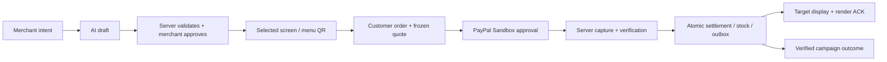

# แผน BitPOS Café Copilot สำหรับ PayPal

วันที่: 12 ตุลาคม 2026 — **แผนพัฒนา ยังไม่ใช่ implemented/verified feature list**

## 1. ปัญหาและเรื่องที่เราจะนำเสนอ

เจาะร้านกาแฟที่มีสินค้าขายได้ในช่วงเวลาจำกัด โดยเริ่มตรวจความต้องการจากร้านที่เข้าถึงได้ โจทย์ตัวอย่าง: “ช่วยขายครัวซองต์ที่เหลือ 8 ชิ้นก่อน 16:00 ลดไม่เกิน 10%” ให้ AI อ่านข้อมูลจริง เสนอโปรด้วย typed tools และแสดงสิ่งที่ต้องให้คนขายอนุมัติ เมื่อลูกค้าซื้อจะจ่ายด้วย PayPal Sandbox และวัดผลจาก capture ที่ server ยืนยันแล้ว จำนวน 8 ชิ้น/เวลา/ส่วนลดนี้เป็น fixture ตัวอย่าง ไม่ใช่หลักฐานร้านจริง

**ชื่อเสนอ:** BitPOS Café Copilot  
**English hook:** “Sell today's surplus with a bounded AI agent and verified PayPal payments.”

ข้อเสนอความต่างที่ต้องพิสูจน์คือ agent จัดการข้อจำกัดจำนวน/ส่วนลด/เวลา ส่งโปรเฉพาะจอที่ร้านเลือก และปิดวงจรด้วย provider evidence เปรียบเทียบกับการทำโปรด้วยมือและ rule/template เดิม ส่วนการลดของเสีย/เพิ่มยอดขายยังเป็นสมมติฐาน ไม่ใช้ภาพ field trial หรือ sandbox payment เป็นหลักฐานรายได้ ดู กลยุทธ์และ evidence gates (`WIN_STRATEGY_TH.md`, private)

คำขอเป้าชนะ 80% เป็นความต้องการของผู้ใช้ ยังไม่ใช่ probability ที่คำนวณได้ แผนนี้เพิ่มคุณภาพงานตามเกณฑ์ตัดสิน โดยไม่เปลี่ยนคะแนนความพร้อมภายในให้เป็นโอกาสชนะ

## 2. MVP ที่ควรส่ง

| ลำดับ | สิ่งที่จะสร้าง/ใช้ | เกณฑ์เสร็จ |
|---|---|---|
| P0 | PayPal Sandbox checkout บนเว็บลูกค้า | สั่งได้โดยไม่ต้องมี Phantom; create/approve/capture และตรวจ paid ฝั่ง server จริง |
| P0 | AI agent อ่าน stock/merchant intent และเสนอ draft ผ่าน typed tools | มี real model/tool trace พร้อม provider/model/time; server validate และคนขาย preview/edit/approve; เทียบ manual/rules baseline |
| P0 | campaign quantity/time/discount envelope | ร้านกำหนดสินค้า จำนวนสูงสุด เวลาจบ และส่วนลด; reservations ใช้ stock ledger ร่วมเดิม ไม่ขายเกินเมื่อหลาย order/campaign พร้อมกัน |
| P0 | ส่งโปรไปยังจอที่คนขายเลือก | ผูก offer กับ target/session; QR เข้าสู่เมนูที่ใช้ส่วนลดถูกต้อง ไม่ broadcast |
| P0 | settlement → stock/receipt/outbox → paid display | capture ถูกต้องหนึ่งครั้ง มี payment provider/currency จริง และ render ACK |
| P0 | campaign outcome พร้อม evidence trace | ผูก intent/draft/approval/offer/quote/capture/outbox ACK; นับ verified captures แยก pending/cancel/refund และ paid/collected; คำนวณด้วย code |
| P0 | เส้นทางกรรมการบน browser | ใช้ backend/PayPal จริง; terminal simulator ระบุว่า simulator; ไม่ต้องซื้อ hardware เพื่อทดสอบหลัก |
| P1 | AI อธิบายผลโปรจาก aggregate ที่คำนวณแล้ว | อ้างช่วงเวลา/sample size; ไม่สร้างยอดเงินหรือเหตุและผลเอง |
| P1 | เพิ่ม agent checkout assistance | ทำต่อเมื่อ core ผ่านแล้ว; customer ยังอนุมัติจ่ายเอง ไม่มี arbitrary capture/refund/payout |

ไม่อยู่ใน MVP: mainnet, live PayPal, fiat-to-crypto, swap/bridge, Venmo, subscription, payout, อัตโนมัติคืนเงินโดย AI, loyalty/NFT ใหม่ หรือ full legacy 25-page parity การเลือก scope นี้ไม่ลบฟีเจอร์เดิม ช่องว่าง parity ต้องยังเปิดเผยตาม [source provenance](../docs/SOURCE_PROVENANCE.md)

## 3. เส้นทางเดโม

1. คนขายเปิด AI Promotions ระบุสินค้าที่ต้องการขาย จำนวนสูงสุด เวลาจบ และเพดานส่วนลด พร้อม stock ที่แสดงแหล่งข้อมูลชัดเจน
2. AI อ่านข้อมูลผ่าน authorized tools ส่ง draft พร้อม rationale; backend ตรวจ product IDs, available stock, quantity cap, discount, expiry และราคาที่คำนวณเอง แสดง tool trace แบบย่อให้กรรมการดูรายละเอียดได้
3. คนขายแก้/อนุมัติ เลือก BitPOS Mini หรือ browser terminal หนึ่งเครื่อง แล้วกดยืนยันส่ง
4. ลูกค้าสแกน QR ของโต๊ะ เลือกเมนู เห็นราคาที่ server quote; offer หมดอายุ/stock เปลี่ยนให้ review ใหม่
5. ลูกค้าเปิด PayPal checkout และอนุมัติด้วย sandbox buyer; server capture และตรวจ provider evidence ก่อน paid
6. บิลและ stock เปลี่ยนครั้งเดียว จอเป้าหมายแสดง paid; staff เตรียม → Ready → Collected ตาม fulfillment ที่แยกจากการจ่าย
7. Dashboard แสดงจำนวน paid/collected และ PayPal gross/refund ของโปรนี้ พร้อม evidence IDs หาก webhook ซ้ำตัวเลขต้องไม่เพิ่ม ถ้ามี AI commentary ต้องผูกกับ aggregate เดียวกัน

## 4. ขอบเขตโค้ดและงานที่ซ้อนอยู่

`PayPal/` เป็น competition package; ใช้ source BitPOS ชุดเดิม ไม่ตั้ง POS/firmware fork ซ้ำในโฟลเดอร์นี้

| พื้นที่ | งานวางแผน |
|---|---|
| `apps/api/src/` | PayPal provider adapter, create/capture/status, webhook inbox, reconciliation, merchant policy |
| `apps/web/src/` | ตัวเลือก PayPal + hosted SDK session, cancel/pending/retry, AI review และ outcome UI |
| `packages/domain/`, `packages/contracts/` | provider-neutral quote/payment proof/paid display; runtime validation ไม่ใช้ type assertions กลบ incompatibility |
| `supabase/migrations/` | additive provider records, unique constraints, order-level payment mutex, verified settlement/inbox/recovery และ campaign envelope/quantity cap บน stock ledger เดิม |
| `apps/worker/` | retry/reconcile capture และ webhook jobs ผ่าน durable state |
| `device/firmware/` | display provider/amount/currency, campaign/pickup capabilities ตาม version; keys อยู่ server |
| `tests/`, `tools/runtime/` | focused negative/recovery checks และ sandbox evidence |

ขณะสำรวจมี OMP owner งาน `post-submit-20261012` ทำ pickup A / multi-asset B / AI C อยู่ ต้องประสาน ownership ก่อนแก้ไฟล์ร่วมและเลือก migration number จากสถานะจริง ไม่เปิด writer อีกตัวบนไฟล์เดียวกัน งานรอบนี้เพิ่มเอกสารเท่านั้น

ใช้ Supabase/OCI BitPOS ชุดเดิม ตรวจ backup/capacity/migration ก่อนเปลี่ยน schema และแยก sandbox tenant/data identities จากข้อมูลร้านเดิม ไม่แตะ CryptoClock/Cashless workspace, ไม่สร้าง staging stack อีกชุด

## 5. PayPal adapter ที่ต้องออกแบบให้ถูก

เริ่ม single sandbox merchant + แยก sandbox buyer ใช้ Orders v2 แบบ `CAPTURE` และ PayPal JavaScript SDK บนเว็บ [PayPal SDK setup](https://developer.paypal.com/sdk/js/set-up) ให้ spike ยืนยัน SDK/version/eligibility ที่ใช้งานจริงก่อนล็อก dependency; ไม่ย้ายไป marketplace/multi-seller platform เพียงเพราะตัวอย่างบางหน้ามี partner headers

### Quote และ data model

- catalog สำหรับ PayPal MVP เลือก **USD 2 decimals**; ราคา USDG 6 decimals เดิมไม่ใช่ USD cents ห้ามเปลี่ยน label หรือหารโดยเดาว่าเป็น FX หากร้านใช้ USDG catalog ต้องมี policy/quote conversion ที่ตกลงก่อนเปิด PayPal
- เก็บ canonical `quote_id`, `price_version`, `amount_minor`, `currency=USD`, `provider=paypal`, `environment=sandbox`, `merchant_account_id`, order attribution และ expiry ใช้ integer/decimal string แปลง API amount อย่างแน่นอน ไม่ใช้ floating point
- Freeze quote ก่อน create; browser ส่ง order/quote ID ไม่เป็นผู้กำหนดยอด ตรวจ customer order token/session หรือ staff role และ tenant ทุก endpoint
- schema เดิมของ `payment_attempts/payments` บังคับ Solana mint/program/payer/signature และ order บางสถานะรอ wallet จึงต้องออกแบบ provider-neutral ledger/extension จริง ไม่ใส่ PayPal ID ในช่อง signature หรือสร้าง wallet ปลอม
- แยก `paypal_order_id`, `capture_id`, `webhook_event_id`, request IDs และ proof type; unique โดย provider/environment/account/id ให้ route เดิมและ PayPal ใช้ order-level lock ร่วมกัน
- ก่อนเปิด PayPal ต้องรักษา legacy paid/quote/stock evidence และ USDG regression; versioned contracts ต้องรองรับจอรุ่นเก่าหรือแสดง unsupported ชัดเจน

### Verify และ settle

1. server สร้าง PayPal order จาก frozen quote พร้อม reference/invoice/custom attribution ตาม API ที่ตรวจแล้ว เก็บ provider ID **ก่อน** คืน checkout session
2. buyer approve บน PayPal; callback เป็นเพียง trigger ให้ server ทำ capture ไม่เป็นหลักฐาน paid
3. ตรวจจาก authenticated PayPal API: expected order/capture IDs, `COMPLETED` capture, gross amount/currency ตรง quote, payee merchant ตรง, environment/app attribution ตรง และ order binding ตรง ไม่ใช้ net หลังหัก fee เทียบราคาขาย
4. callback, webhook และ reconciliation เข้าทาง settlement function เดียวกัน ล็อก order ตรวจ unique constraints แล้ว commit paid + inventory + durable outbox ใน transaction
5. ใช้ `PayPal-Request-Id` แยกตาม operation และเก็บคงเดิมตอน retry ตรวจ retention ของ endpoint จริง; timeout ให้ reconcile ก่อนสร้าง request ใหม่ [Idempotency](https://developer.paypal.com/api/rest/reference/idempotency/)
6. มี durable webhook inbox ตรวจ signature ด้วย registered webhook ID/environment ก่อนรับผลทางธุรกิจ เก็บ raw body และหลักฐานแบบ private/redacted; ACK หลังรับเข้า durable queue แล้ว [Webhook integration](https://developer.paypal.com/api/rest/webhooks/rest/)
7. `APPROVED`, `PENDING`, cancel หรือ SDK success ยังไม่ settle; late capture/quote expired/stock released เป็น recovery ต้องไม่หายและไม่บังคับ fulfilled
8. capture และ Solana ที่ยังไม่รู้ผลห้ามสลับช่องทางทันที ถ้าสำเร็จสอง provider จริง เก็บหลักฐานเงินทั้งสองและเปิด overpayment/refund recovery ไม่ทิ้ง payment ที่สองเพราะ order paid แล้ว
9. refund/reversal เป็น ledger event แยก ไม่ย้อนบิล/stock โดยอัตโนมัติ และไม่ทำให้จอแจ้ง paid ซ้ำ

Webhook simulator ใช้ทดสอบ listener ได้ แต่ไม่ใช่หลักฐานว่าชำระจริงบน sandbox; postback verification ใช้กับ mock events ไม่ได้ตามเอกสาร PayPal ต้องมี actual sandbox transaction/event เพิ่ม

## 6. AI ที่เป็นฟีเจอร์ในสินค้า

ใช้ approved provider/model/budget ผ่าน server adapter เดิมของงาน C เมื่อพร้อม รอบสำรวจ checkpoint ยังรายงานว่าไม่มี configuration/budget สำหรับ model จริง จึงยังไม่เลือก provider หรือรับรองการเรียกใช้งาน

- ส่งเฉพาะเมนู stock และ aggregate ภายใน tenant; งด contact/payment secrets ใน prompt
- input/output schema จำกัด product IDs, percentage bounds, time window, target และข้อความ; server คิดราคา/สิทธิ์เอง พร้อม revalidate ตอน publish และ quote
- แยก model draft จาก deterministic fallback; fallback/fixtures ต้องมีป้าย ไม่มีแอบเรียกว่า AI response
- Generate ไม่เปิดโปร; approved campaign ต้องเลือกจอและยืนยันส่งตาม flow ปัจจุบัน ไม่เปลี่ยนเป็น autonomous broadcast
- Agent tools P0 จำกัด `read_available_stock`, `read_merchant_limits`, `validate_offer`, `save_draft`, `read_verified_outcomes` ผ่าน tenant/role wrapper; ไม่มี tool publish/capture/refund/payout ให้โมเดล Server orchestrator ใช้ approval แยกจากข้อความของโมเดล
- Merchant envelope เก็บ SKU IDs, quantity cap, starts/ends, max discount, target/session และ approval version; เปลี่ยนขอบเขตต้อง review/confirm ใหม่ ไม่ให้ agent auto-reprice หรือเพิ่มจำนวนขายเอง
- จองสิทธิ์จำนวน campaign และสินค้าใน transaction เดียวกัน นับ active reservations + consumed units ไม่ใช่นับเฉพาะ paid ภายหลัง; quote เก็บ policy/version/validity ที่ freeze ไว้ การหมดอายุหยุด quote ใหม่และไม่เขียนราคาบิลเก่า Refund ไม่คืน stock/สิทธิ์ขายเองหากไม่มี fulfillment policy รองรับ
- เมื่อ stock หมด/โปรหมดอายุ ใช้ deterministic invalidation ปฏิเสธ quote ใหม่; captured late เป็น recovery ตาม payment policy ไม่กล่าวว่า agent รับประกันยอดขายหรือความปลอดภัยอาหาร
- Margin เป็น optional policy เฉพาะมีต้นทุนที่ร้านยืนยัน ถ้าขาด cost/fee data แสดง unknown; ห้ามให้ AI เดาต้นทุน กำไรสุทธิ หรือเวลาที่อาหารยังปลอดภัย
- Outcome ใช้ verified captures และ campaign/offer/order attribution; แสดง refunds แยก และห้ามรวม sandbox กับยอดจริง
- วัด generation latency, validation rejection, draft approval, checkout completion และ verified amount จากข้อมูลจริง ใช้ fixture เป็น fixture ไม่อ้าง sales uplift/causal improvement

PayPal Agent Toolkit เป็นทางเลือกสำหรับ P1 หลัง spike ดู [official repository](https://github.com/paypal/agent-toolkit) ใช้ sandbox และ allowlist tools เท่าที่จำเป็นผ่าน BitPOS authorization wrapper ไม่ใช้ `ALL_TOOLS_ENABLED` ไม่เปิด arbitrary capture/refund/payout ให้โมเดล API credentials อยู่ใน adapter ฝั่ง server ไม่ส่งให้โมเดล การใช้ toolkit ไม่ใช่ข้อบังคับของรายการ และ coding plugin/MCP ไม่เท่ากับ in-product AI

## 7. จอและการทดสอบที่ต้องมี

จอแสดง `PayPal · USD` และยอดจาก quote/proof ไม่แสดงว่าเป็น token transfer, Phantom หรือ on-chain finalization ห้ามทับ active payment ด้วย promotion/pickup เก็บ assignment/session generations, dedup, TTL และ reconnect snapshot แบบไม่เล่นเสียงซ้ำ วัด backend verified → physical render ACK แยกจากเวลา approve/capture ของ PayPal

| กลุ่มทดสอบ | เกณฑ์ผ่านก่อนส่ง |
|---|---|
| Happy path | AI จริง → review/approve → PayPal actual sandbox capture → paid/stock/receipt → จอที่ถูกต้อง; สำคัญกรณีละ 3 รอบตามนโยบายเดิม |
| Proof/authorization | forged callback/webhook, wrong amount/currency/payee/order/environment, tenant crossing ถูกปฏิเสธ |
| Retry/crash | duplicate approve/capture/webhook, capture timeout, inbox/worker restart ไม่ settle/ตัด stock/แจ้งซ้ำ |
| State transitions | pending/cancel/late completion/expiry/refund/reversal และสอง provider พร้อมกันเข้าสถานะถูกต้อง ไม่มีหลักฐานเงินหาย |
| AI policy | prompt injection, malformed output, price/stock changed, excessive discount, expired target ไม่ publish โดยพลการ |
| Campaign cap | concurrent orders/campaigns, reservation expiry, late capture และ refund ไม่ขายเกิน approved cap/stock; frozen quote/history ไม่ถูกแก้ย้อนหลัง |
| Routing | wrong/stale device, offline/busy/reconnect, generation changed; event ไม่ไปโต๊ะอื่น |
| Judge setup | fresh checkout + documented config + sandbox buyer ทดสอบได้; browser simulator ใช้ backend จริงและติดป้าย |
| Regression | USDG devnet และ paid history เดิม, TH/EN, server roles, stock/order consistency ไม่เปลี่ยนผิด |

ใช้ fixture/unit tests ตรวจ failure paths และใช้ actual PayPal Sandbox integration ตรวจ provider semantics แยก evidence กัน Hardware clip/build/host harness ไม่เท่ากับ physical touch/audio proof ถ้า firmware เปลี่ยนต้องมี acceptance ใหม่ก่อนแสดงว่าใช้ได้บนจอจริง

## 8. ลำดับเวลาเสนอ

| ช่วงเวลาไทย | ผลงานและ gate |
|---|---|
| 12–14 ต.ค. | ตรวจ eligibility/access/ownership, สัมภาษณ์คนขายเป้า 2–3 คน และตรวจโจทย์สินค้าคงเหลือ; spike PayPal/AI พร้อม baseline และ go/no-go ตาม strategy |
| 15–20 ต.ค. | provider-neutral quote/ledger + PayPal create/capture/webhook/reconcile; negative/retry checks ผ่านก่อนต่อเดโม |
| 21–25 ต.ค. | รวมงาน C real AI tools/draft/approval/scoped offer, quantity/time envelope + evidence attribution; เริ่ม formative user tests ทันที |
| 26–29 ต.ค. | browser + Mini display, pickup integration และ physical acceptance ที่เกี่ยวข้อง |
| 30 ต.ค.–3 พ.ย. | recovery/security/USDG regression, fresh judge setup, formative pilot/เทียบ manual-rules baseline และ independent review ตาม workflow ของทีม |
| 4–8 พ.ย. | English judge packet, provenance/diff, screenshots, YouTube demo 2:50 และทดสอบ access |
| 9–11 พ.ย. | ตรวจ latest rules, freeze source tag/evidence, ส่งจริงเป้า 11 พ.ย. 18:00 ไทย |
| ถึง 15 ธ.ค. 23:00 | รักษา judge access และ submission build ตามกติกา ไม่เปลี่ยนสาระ submission หลัง deadline โดยพลการ |

เป็นแผนเป้าหมาย ไม่ใช่กำหนดที่รับประกัน ขึ้นกับงาน A/B/C เดิม, sandbox access, AI budget และ hardware availability หากเวลาไม่พอ ตัด P1 ก่อน ใช้ working browser terminal สำหรับการทดสอบหลัก แต่ไม่ตัด PayPal/AI จริงหรือเกณฑ์ proof/recovery

## 9. สิ่งที่ต้องพร้อมก่อนเริ่ม runtime

บัญชี Developer/Sandbox ของทีมและ merchant/buyer แยก, private client secret/webhook ID, approved AI model/budget, baseline/source ownership และ schema design ที่ไม่ทำลายข้อมูลเดิม งานนี้ยังไม่ใช่การอนุญาตเปิด live PayPal/mainnet หรือเรียก AI ที่มีค่าใช้จ่ายโดยไม่กำหนดงบ

ถัดไปเริ่ม readiness/discovery และ sandbox spike แล้วลง provider data design กับผู้ดูแลงาน A/B/C ก่อน implementation ใช้ evidence gates ใน WIN_STRATEGY_TH.md (`WIN_STRATEGY_TH.md`, private) ตัด scope ที่ไม่ช่วยพิสูจน์โจทย์ก่อน ไม่ต้องรอสร้างเว็บไซต์ประชาสัมพันธ์ใหม่
